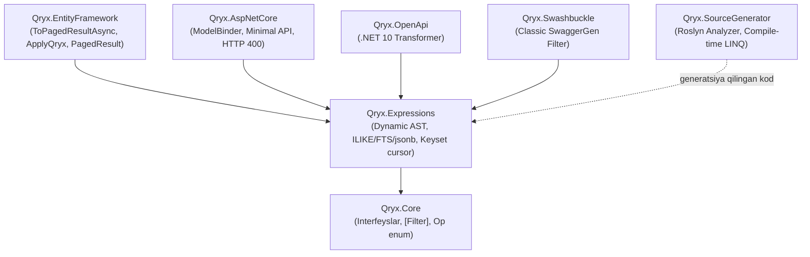

# 📖 Qryx: Dasturchilar uchun To'liq Qo'llanma (Developer Usage Guide)

> **Parser-free, DTO-Centric, Strongly-Typed Dynamic Query Engine for .NET 10 / C# 14**  
> Ushbu qo'llanmada Qryx ekotizimidan professional loyihalarda foydalanish, barcha 7 ta NuGet paketining imkoniyatlari, eng optimal arxitekturaviy patternlar va eng asosiysi — **ishlab chiqarish (production) muhitidagi kritik nuqtalar** batafsil tushuntirilgan.

---

## 📑 Mundarija

1. [Qryx Ekotizimi va Paketlar](#1-qryx-ekotizimi-va-paketlar)
2. [Tez Boshlash (5 daqiqada integratsiya)](#2-tez-boshlash-5-daqiqada-integratsiya)
3. [DTO Loyihalash (Barcha Filtr Turlari)](#3-dto-loyihalash-barcha-filtr-turlari)
   - [3.1. Tenglik va Solishtirish (`Equals`, `GreaterThan`, `LessThan`)](#31-tenglik-va-solishtirish)
   - [3.2. Avtomatik Prefikslar (`Min`, `Max`, `From`, `To`)](#32-avtomatik-prefikslar-min-max-from-to)
   - [3.3. To'plamlar va Massivlar (`In`, `NotIn`)](#33-toplamlar-va-massivlar-in-notin)
   - [3.4. Matnli Qidiruv va Invariantlik (`StartsWith`, `Contains`, `EndsWith`)](#34-matnli-qidiruv-va-invariantlik-startswith-contains-endswith)
   - [3.5. Multi-Target (Kompozit/Hisoblangan maydonlar)](#35-multi-target-kompozithisoblangan-maydonlar)
   - [3.6. Bog'langan Jadvallar (Navigation Properties)](#36-boglangan-jadvallar-navigation-properties)
   - [3.7. Ilg'or Operatorlar: Full-Text Search (FTS) va JSONB](#37-ilgor-operatorlar-full-text-search-fts-va-jsonb)
   - [3.8. Oraliq Filtri (`Op.Between` + `Range<T>`)](#38-oraliq-filtri-opbetween--ranget)
   - [3.9. URL Ma'lumotnomasi: Operatorlar Query String'da](#39-url-malumotnomasi-operatorlar-query-stringda)
4. [Sahifalash (Pagination) Strategiyalari va Saralash](#4-sahifalash-pagination-strategiyalari)
   - [4.1. Har bir sahifa bitta so'rov (`hasNext`)](#41-har-bir-sahifa-bitta-sorov-hasnext)
   - [4.2. Umumiy son (`includeTotal=true`)](#42-umumiy-son-includetotaltrue)
   - [4.3. Keyset / Cursor (`afterCursor` + `nextCursor`)](#43-keyset--cursor-aftercursor--nextcursor)
   - [4.4. Zero-Copy Streaming (`ToPagedAsyncEnumerable`)](#44-zero-copy-streaming-topagedasyncenumerable)
   - [4.5. Ko'p Ustunli Saralash (Multi-Column Sorting)](#45-kop-ustunli-saralash-multi-column-sorting)
5. [Projection Pushdown (Optimizatsiya)](#5-projection-pushdown-optimizatsiya)
6. [Roslyn Incremental Source Generator Rejimi](#6-roslyn-incremental-source-generator-rejimi)
7. [API Integratsiyasi (Minimal API & Controller)](#7-api-integratsiyasi-minimal-api--controller)
8. [Swagger & OpenAPI Hujjatlashtirish (va Sample API)](#8-swagger--openapi-hujjatlashtirish)
9. [🚨 KRITIK NUQTALAR VA XATOLARNING OLDINI OLISH](#9--kritik-nuqtalar-va-xatolarning-oldini-olish)
10. [Ma'lumotlar Bazasi Indekslash Retseptlari (DB Recipes)](#10-malumotlar-bazasi-indekslash-retseptlari-db-recipes)
11. [Qryx vs Gridify vs Sieve vs OData (Benchmark Xulosalari)](#11--qryx-vs-gridify-vs-sieve-vs-odata-benchmark-xulosalari)

---

## 1. Qryx Ekotizimi va Paketlar

Qryx toza arxitektura tamoyillariga asoslangan mustaqil modullardan iborat:



| Paket Nomi | Qachon O'rnatish Kerak? | Asosiy Vazifasi |
| :--- | :--- | :--- |
| **[`Qryx.Core`](https://www.nuget.org/packages/Qryx.Core/)** | Domain/Application layer (DTO'lar joylashgan qatlam) | Hech qanday bog'liqliksiz DTO shartnomalari (`QryxRequest<T>`, `[Filter]`, `[Sortable]`, `[NoTotal]`, `Op`, `Range<T>`, `QryxList<T>`, `QryxRequestException`) |
| **[`Qryx.Expressions`](https://www.nuget.org/packages/Qryx.Expressions/)** | Application/Infrastructure | Reflection'siz dynamic expression tree yasash, parametrli SQL, oldindan tayyorlangan filtr rejalari, PostgreSQL `ILIKE` / FTS / jsonb tarjimasi, keyset cursor, `QryxOptions` |
| **[`Qryx.EntityFramework`](https://www.nuget.org/packages/Qryx.EntityFramework/)** | Infrastructure / Data Access | EF Core extensionlari (`ToPagedResultAsync`, `ToPagedAsyncEnumerable`, `ApplyQryx`, `PagedResult<T>`, ixtiyoriy `TagWith`) |
| **[`Qryx.AspNetCore`](https://www.nuget.org/packages/Qryx.AspNetCore/)** | Presentation / Web API | HTTP Query String parametrlarini bog'lash (`QryxDtoModelBinder`), klient xatolarini HTTP 400 ga aylantirish |
| **[`Qryx.SourceGenerator`](https://www.nuget.org/packages/Qryx.SourceGenerator/)** | Web API / Application (Analyzer sifatida) | Kompilyatsiya vaqtida `query.ApplyGenerated(dto)` kodini generatsiya qilish, `QRYX001`/`QRYX002` diagnostikalari |
| **[`Qryx.OpenApi`](https://www.nuget.org/packages/Qryx.OpenApi/)** | Web API (.NET 10 yangi OpenAPI) | `Microsoft.AspNetCore.OpenApi` sxemalarini DTO maydonlariga moslashtirish |
| **[`Qryx.Swashbuckle`](https://www.nuget.org/packages/Qryx.Swashbuckle/)** | Web API (Classic Swagger UI) | `Swashbuckle.AspNetCore` da Qryx parametrlarini (filtrlar, `sortBy` maydonlari, sahifalash) to'g'ri ko'rsatish |

O'rnatish:
```bash
dotnet add package Qryx.AspNetCore
dotnet add package Qryx.EntityFramework
```
`Qryx.Core` va `Qryx.Expressions` bog'liqlik sifatida avtomatik o'rnatiladi.

---

## 2. Tez Boshlash (5 daqiqada integratsiya)

### 1-qadam: DTO e'lon qilish
```csharp
using Qryx.Core.Attributes;
using Qryx.Core.Contracts;
using Qryx.Core.Enums;

namespace MyApp.Features.Users;

public record GetUsersQuery : QryxRequest<User>
{
    [Filter(nameof(User.Age), Op.GreaterThanOrEqual)]
    public int? MinAge { get; init; }

    [Filter(nameof(User.Age), Op.LessThanOrEqual)]
    public int? MaxAge { get; init; }

    [Filter(Op.Equals)]
    public string? Status { get; init; }

    [Filter(Op.StartsWith, TargetProperties = [nameof(User.FirstName), nameof(User.LastName)])]
    public string? Search { get; init; }
}
```

### 2-qadam: `Program.cs` sozlash
Bu misol uchun `Qryx.AspNetCore`, `Qryx.EntityFramework`, `Qryx.Swashbuckle` va `Npgsql.EntityFrameworkCore.PostgreSQL` paketlari kerak.
```csharp
using Microsoft.EntityFrameworkCore;
using Qryx.AspNetCore.Extensions;
using Qryx.EntityFramework.Extensions;
using Qryx.Swashbuckle.Extensions;

var builder = WebApplication.CreateBuilder(args);

builder.Services.AddDbContext<AppDbContext>(opt => 
    opt.UseNpgsql(builder.Configuration.GetConnectionString("Default")));

builder.Services.AddQryx();

builder.Services.AddEndpointsApiExplorer();
builder.Services.AddSwaggerGen(c => c.AddQryxFilters());

var app = builder.Build();

app.UseSwagger();
app.UseSwaggerUI();

app.MapGet("/api/users", async (
    [AsParameters] GetUsersQuery query,
    AppDbContext db,
    CancellationToken ct) =>
{
    var paged = await db.Users
        .AsNoTracking()
        .ToPagedResultAsync(query, ct);

    return Results.Ok(paged);
}).WithQryx();

app.Run();
```

---

## 3. DTO Loyihalash (Barcha Filtr Turlari)

### 3.1. Tenglik va Solishtirish
```csharp
public record ProductFilterDto : QryxRequest<Product>
{
    // WHERE x.CategoryId == request.CategoryId
    [Filter(Op.Equals)]
    public int? CategoryId { get; init; }

    // WHERE x.Price > request.MinPrice
    [Filter(nameof(Product.Price), Op.GreaterThan)]
    public decimal? MinPrice { get; init; }

    // WHERE x.IsArchived != request.NotArchived
    [Filter(nameof(Product.IsArchived), Op.NotEquals)]
    public bool? NotArchived { get; init; }
}
```

### 3.2. Avtomatik Prefikslar (`Min`, `Max`, `From`, `To`)
Qryx eng toza URL parametrlarini qo'llab-quvvatlaydi. Agar DTO xossasi nomi `Min*`, `Max*`, `From*`, `To*` prefiksi bilan boshlansa va `TargetProperty` berilmasa, prefiksdan keyingi nom Entity ustuniga avtomatik moslashtiriladi:

```csharp
public record OrderFilterDto : QryxRequest<Order>
{
    // Avtomatik ravishda Order.TotalAmount ustuniga >= qilib bog'lanadi:
    [Filter(Op.GreaterThanOrEqual)]
    public decimal? MinTotalAmount { get; init; }

    // Avtomatik ravishda Order.CreatedAt ustuniga <= qilib bog'lanadi:
    [Filter(Op.LessThanOrEqual)]
    public DateTime? ToCreatedAt { get; init; }
}
```
> **URL ko'rinishi:** `GET /api/orders?minTotalAmount=500&toCreatedAt=2026-12-31`

### 3.3. To'plamlar va Massivlar (`In`, `NotIn`)
Mijoz bir vaqtning o'zida bir nechta qiymat berishi mumkin (`?status=Active&status=Pending`):
```csharp
public record UserBatchDto : QryxRequest<User>
{
    // WHERE x.Status IN ('Active', 'Pending')
    [Filter(Op.In)]
    public string[]? Status { get; init; }

    // WHERE x.RoleId NOT IN (1, 2)        (?excludedRoles=1&excludedRoles=2)
    [Filter(nameof(User.RoleId), Op.NotIn)]
    public int[]? ExcludedRoles { get; init; }

    // Vergul bilan ham, takroriy kalit bilan ham: ?roleIds=1,2,3 yoki ?roleIds=1&roleIds=2
    [Filter(nameof(User.RoleId), Op.In)]
    public QryxList<int>? RoleIds { get; init; }
}
```
> [!WARNING]
> **Minimal API (`[AsParameters]`) da `List<T>` ishlatmang.** ASP.NET Core `List<T>` xossasini query'dan bog'lay olmaydi, uni request body deb hisoblaydi va ilova ishga tushishida (endpoint qurilayotganda) xato beradi ("Body was inferred..."). Minimal API'da massiv (`T[]`, takroriy kalit) yoki `QryxList<T>` (vergul yoki takroriy kalit) ishlating. MVC (`[FromQuery]`) da esa Qryx binder'i `T[]`, `List<T>` va `QryxList<T>` ning barchasini bog'laydi. `QryxList<T>` uchun `using Qryx.Core.Types;` kerak.

### 3.4. Matnli Qidiruv va Invariantlik (`StartsWith`, `Contains`, `EndsWith`)
Qryx `StartsWith`, `EndsWith` va `Contains` operatorlariga ega. Ma'lumotlar bazasi B-Tree indekslaridan maksimal foydalanish uchun Qryx provayderga xos aqlli optimizatsiyani amalga oshiradi:

```csharp
public record CustomerFilterDto : QryxRequest<Customer>
{
    // 1. Invariant = false (Standart qiymat) -> Direct LIKE
    // PostgreSQL, SQL Server, Oracle va SQLite'da to'g'ridan-to'g'ri:
    // WHERE x."CompanyName" LIKE @p_startswith        (@p_startswith = 'Tech%')
    // Hech qanday lower() yoki upper() o'ralmaydi, B-Tree indeksi ishlaydi
    // (PostgreSQL'da "C" collation yoki varchar_pattern_ops indeksi bilan, 10-bo'limga qarang)!
    [Filter(Op.StartsWith)]
    public string? CompanyName { get; init; }

    // 2. Invariant = true (Case-insensitive qidiruv)
    // A) PostgreSQL da: to'g'ridan-to'g'ri native ILIKE ga aylanadi:
    //    WHERE x."Email" ILIKE @p ESCAPE '\'           (@p = 'ali%')
    //    Foydalanuvchi kiritgan '%', '_' va '\' escape qilinadi: "50%" faqat "50%" ni topadi.
    // B) SQL Server, SQLite, Oracle da: UPPER() fallback:
    //    WHERE UPPER(x."Email") LIKE @p                (@p = 'ALI%', klient tomonda ToUpperInvariant)
    //    UPPER(ustun) oddiy B-Tree indeksdan foydalanmaydi: kerak bo'lsa UPPER(ustun) bo'yicha funksional indeks yarating.
    [Filter(Op.StartsWith, Invariant = true)]
    public string? Email { get; init; }

    // Katta-kichik harfni ajratuvchi qat'iy substring qidiruvi:
    [Filter(Op.Contains, Invariant = false)]
    public string? ExactCode { get; init; }
}
```
> `Invariant = false` da katta-kichik harf farqi bazaning o'ziga bog'liq: PostgreSQL `LIKE` sezgir, SQL Server'ning standart kolatsiyasi (`*_CI_*`) va SQLite `LIKE` (ASCII) esa sezgir emas.

### 3.5. Multi-Target (Kompozit/Hisoblangan maydonlar)
Bir nechta ustun bo'yicha yagona qidiruv (masalan, `FullName` -> `FirstName` yoki `LastName`):
```csharp
public record StaffFilterDto : QryxRequest<Staff>
{
    // WHERE (x."FirstName" LIKE @p OR x."LastName" LIKE @p0)      (@p = @p0 = 'Ali%')
    // Invariant = true bo'lsa PostgreSQL'da har bir ustun uchun ILIKE ishlatiladi.
    [Filter(Op.StartsWith, TargetProperties = [nameof(Staff.FirstName), nameof(Staff.LastName)])]
    public string? FullName { get; init; }
}
```
> [!TIP]
> Qryx `Expression.OrElse` orqali SQL `OR` shartini hosil qiladi. Ma'lumotlar bazasi ikkala ustundagi B-Tree indekslarini `Bitmap Index Scan` (PostgreSQL) yoki `Index Union` (SQL Server) orqali birlashtirib, eng yuqori tezlikni ta'minlaydi.

### 3.6. Bog'langan Jadvallar (Navigation Properties)
Qryx istalgan chuqurlikdagi bog'langan Entity xossalarini nuqta (`.`) orqali qo'llab-quvvatlaydi:
```csharp
public record EmployeeDto : QryxRequest<Employee>
{
    // WHERE x.Department.Name == request.DepartmentName
    [Filter(Op.Equals, TargetProperty = "Department.Name")]
    public string? DepartmentName { get; init; }

    // WHERE x.Company.Country.IsoCode == request.CountryCode
    [Filter(Op.Equals, TargetProperty = "Company.Country.IsoCode")]
    public string? CountryCode { get; init; }
}
```

### 3.7. Ilg'or Operatorlar: Full-Text Search (FTS) va JSONB
```csharp
public record DocumentFilterDto : QryxRequest<Document>
{
    // PostgreSQL:
    //   NpgsqlTsVector ustun -> x."SearchVector" @@ websearch_to_tsquery(@p)
    //   string ustun        -> to_tsvector(x."Body") @@ websearch_to_tsquery(@p)
    // websearch_to_tsquery har qanday foydalanuvchi matnini xatosiz qabul qiladi:
    //   ?searchQuery="red car" -used   (ibora, OR, istisno)
    // Boshqa bazalar: case-insensitive Contains fallback.
    [Filter(Op.Fts, TargetProperty = nameof(Document.SearchVector))]
    public string? SearchQuery { get; init; }

    // PostgreSQL (jsonb ustun):
    //   JSON obyekt/massiv -> x."MetadataJson" @> @p   (?requiredTag={"tag":"new"})
    //   oddiy matn         -> x."MetadataJson" ? @p    (yuqori darajadagi kalit mavjudmi: ?requiredTag=tag)
    // Ikkalasi ham GIN indeksdan foydalanadi. Boshqa bazalar: LIKE Contains fallback.
    [Filter(Op.JsonContains, TargetProperty = nameof(Document.MetadataJson))]
    public string? RequiredTag { get; init; }
}
```

### 3.8. Oraliq Filtri (`Op.Between` + `Range<T>`)
Bitta parametrda ikkala chegara: `from..to`, `from..` yoki `..to` (chegaralar inclusive).
```csharp
public record OrderRangeDto : QryxRequest<Order>
{
    // ?amount=100..500  -> WHERE x."Amount" >= @p AND x."Amount" <= @p0
    [Filter(nameof(Order.Amount), Op.Between)]
    public Range<decimal>? Amount { get; init; }

    // ?createdAt=2026-01-01..   -> faqat pastki chegara
    [Filter(nameof(Order.CreatedAt), Op.Between)]
    public Range<DateTime>? CreatedAt { get; init; }
}
```
> `Range<T>` `IParsable` bo'lgani uchun Minimal API (`[AsParameters]`) va MVC binder uni to'g'ridan-to'g'ri bog'laydi. `from > to` yoki noto'g'ri format 400 qaytaradi.

### 3.9. URL Ma'lumotnomasi: Operatorlar Query String'da
Query kaliti — DTO xossasining **camelCase** nomi (`MinAge` → `minAge`). Kalitlar katta-kichik harfga sezgir emas. Quyidagi har bir misol Minimal API (`[AsParameters]` + `.WithQryx()`) va MVC (`[ApiController]` + `[FromQuery]`) orqali real HTTP so'rov bilan tekshirilgan.

#### Filtr operatorlari

| Operator | DTO xossasi (misol) | URL | SQL (PostgreSQL) |
| :--- | :--- | :--- | :--- |
| `Equals` | `[Filter(Op.Equals)] int? Age` | `?age=29` | `"Age" = @p` |
| `Equals` (enum) | `[Filter(Op.Equals)] Status? Status` | `?status=Active` yoki `?status=1` | `"Status" = @p` |
| `Equals` (Guid / bool / DateTime) | `Guid? Code`, `bool? IsVerified`, `DateTime? CreatedAt` | `?code=1111...-1111` · `?isVerified=true` · `?createdAt=2025-01-01` | `= @p` |
| `NotEquals` | `[Filter(nameof(User.Status), Op.NotEquals)] Status? NotStatus` | `?notStatus=Active` | `"Status" <> @p` |
| `GreaterThan` / `LessThan` | `[Filter(nameof(User.Age), Op.GreaterThan)] int? AgeAbove` | `?ageAbove=30` · `?ageBelow=30` | `"Age" > @p` · `< @p` |
| `GreaterThanOrEqual` / `LessThanOrEqual` (prefiks) | `[Filter(Op.GreaterThanOrEqual)] int? MinAge`, `int? MaxAge` | `?minAge=30&maxAge=40` | `"Age" >= @p AND "Age" <= @p0` |
| Sana oralig'i (prefiks) | `DateTime? FromCreatedAt`, `DateTime? ToCreatedAt` | `?fromCreatedAt=2025-01-01&toCreatedAt=2025-12-31` | `>= @p AND <= @p0` |
| `StartsWith` | `[Filter(Op.StartsWith)] string? Code` | `?code=AB` | `"Code" LIKE @p` (`'AB%'`) |
| `StartsWith` + `Invariant` | `[Filter(..., Op.StartsWith, Invariant = true)] string? FirstNameStarts` | `?firstNameStarts=ali` (Ali, ALISHER ham topiladi) | `ILIKE @p ESCAPE '\'` |
| `EndsWith` / `Contains` | `[Filter(nameof(User.Email), Op.Contains, Invariant = true)] string? EmailContains` | `?emailContains=mail` | `ILIKE '%mail%'` (parametr) |
| Multi-target | `[Filter(Op.StartsWith, TargetProperties = [FirstName, LastName])] string? FullName` | `?fullName=Ali` | `"FirstName" LIKE @p OR "LastName" LIKE @p0` |
| Navigation | `[Filter(Op.Equals, TargetProperty = "Dept.Name")] string? DeptName` | `?deptName=IT` | `JOIN ... "Name" = @p` |
| `In` (massiv) | `[Filter(..., Op.In)] Status[]? Statuses` | `?statuses=Active&statuses=Blocked` | `"Status" = ANY (@p)` |
| `In` (`QryxList<T>`) | `[Filter(..., Op.In)] QryxList<Status>? StatusList` | `?statusList=Active,Blocked` yoki takroriy kalit | `= ANY (@p)` |
| `NotIn` | `[Filter(nameof(User.Id), Op.NotIn)] int[]? ExcludedIds` | `?excludedIds=1&excludedIds=2` | `NOT ("Id" = ANY (@p))` |
| `Between` | `[Filter(nameof(User.Age), Op.Between)] Range<int>? AgeRange` | `?ageRange=26..35` · `?ageRange=30..` · `?ageRange=..28` | `>= @p AND <= @p0` |
| `Between` (sana) | `Range<DateTime>? CreatedRange` | `?createdRange=2024-01-01..2024-12-31` | `>= @p AND <= @p0` |
| `IsNull` | `[Filter(nameof(User.Email), Op.IsNull)] bool? EmailMissing` | `?emailMissing=true` (NULL) · `?emailMissing=false` (NOT NULL) | `IS NULL` · `IS NOT NULL` |
| `IsNotNull` | `[Filter(nameof(User.Email), Op.IsNotNull)] bool? HasEmail` | `?hasEmail=true` | `IS NOT NULL` |
| `Fts` (PostgreSQL) | `[Filter(nameof(Doc.Body), Op.Fts)] string? Search` | `?search="red car" -used` (URL-encoded) | `to_tsvector("Body") @@ websearch_to_tsquery(@p)` |
| `JsonContains` (PostgreSQL jsonb) | `[Filter(Op.JsonContains)] string? Meta` | `?meta={"tag":"new"}` (URL-encoded) · `?meta=tag` | `"Meta" @> @p` · `"Meta" ? @p` |

Bo'sh qiymat (`?minAge=`, `?statuses=`) filtrni o'chiradi: u e'tiborsiz qoldiriladi, xato bermaydi. Takroriy kalitli to'plam uchun Minimal API'da `T[]` ishlating; `List<T>` faqat MVC'da ishlaydi ([3.3-bo'lim](#33-toplamlar-va-massivlar-in-notin)).

#### Sahifalash va saralash parametrlari

| Parametr | URL | Izoh |
| :--- | :--- | :--- |
| `page`, `pageSize` | `?page=2&pageSize=20` | `pageSize` `MaxPageSize` (standart 100) bilan cheklanadi, yo'q yoki `<= 0` bo'lsa `DefaultPageSize` (20); `page < 1` → 1. `(page - 1) * pageSize` `MaxOffset` (10,000) dan oshsa 400 |
| `sortBy` (bitta ustun) | `?sortBy=age desc` | Faqat `[Sortable]` ustunlar; `asc` / `desc` / `ascending` / `descending` |
| `sortBy` (bir nechta ustun) | `?sortBy=status asc, age desc` yoki `?sortBy=age&sortBy=status desc` | Ko'pi bilan 5 ustun, 256 belgi: ortiqcha ustunlar (va 256 belgidan uzun `sortBy` butunlay) e'tiborsiz qoldiriladi, `ThrowOnInvalidSortProperty = true` bo'lsa 400 |
| `isDescending` | `?sortBy=age&isDescending=true` | Yo'nalishi ko'rsatilmagan ustunlar uchun standart yo'nalish |
| `includeTotal` | `?includeTotal=true` | Javobga `total` qo'shiladi (standart holatda o'chiq; `[NoTotal]` DTO'da e'tiborsiz qoldiriladi) |
| `afterCursor` | `?afterCursor=<nextCursor>&sortBy=age desc` | Keyset sahifa (`page` e'tiborsiz qoldiriladi). Avvalgi javobdagi `nextCursor` ni o'zgartirmasdan va **xuddi o'sha `sortBy`** (va `isDescending`) bilan yuboring |

#### Xato javoblari (HTTP 400, `application/problem+json`)

```http
GET /api/users?status=Unknown&ageRange=40..20
```
```json
{
  "status": 400,
  "errors": {
    "status":   ["Value 'Unknown' is not valid for 'status'. Expected one of: Active, Pending, Blocked."],
    "ageRange": ["Value '40..20' is not valid for 'ageRange'. Expected a range 'from..to', 'from..' or '..to' of Int32."]
  }
}
```
Boshqa 400 holatlari: buzilgan yoki boshqa `sortBy` uchun yaratilgan `afterCursor`, keyset'ni qo'llab-quvvatlamaydigan saralashda (nullable ustun yoki developer'ning o'z `.OrderBy(...)` i) yuborilgan `afterCursor`, `MaxOffset` dan chuqur `page`, 1,000 dan ortiq `In` qiymatlari, `ThrowOnInvalidSortProperty = true` bo'lganda ruxsatsiz `sortBy`.

#### ⚠️ Enum qiymatlari: Minimal API va MVC farqi

| Holat | Minimal API (`[AsParameters]`) | MVC (`[FromQuery]`) |
| :--- | :--- | :--- |
| `?status=Active` / `?status=1` | ✅ | ✅ |
| `?status=active` (kichik harf) | ❌ 400 — enum nomlari **katta-kichik harfga sezgir** (ASP.NET Core binder'i) | ✅ (sezgir emas) |
| `?statuses=Active&statuses=Blocked` (massiv) | ✅ | ✅ |
| `?statuses=Active,Blocked` (massiv, vergul) | ❌ 400 | ❌ 400 |
| `?statusList=Active,Blocked` (`QryxList<T>`) | ✅ | ✅ |

> **Nega vergulli enum rad etiladi?** .NET'ning `Enum.TryParse` funksiyasi `"Active,Blocked"` ni `[Flags]` kombinatsiyasi deb o'qiydi: `Active | Blocked = 0 | 2 = Blocked`. Natijada filtr jimgina noto'g'ri bo'lib qoladi va faqat `Blocked` qatorlari qaytadi. Qryx bunday so'rovni 400 bilan rad etadi. Vergul bilan bir nechta qiymat yuborish kerak bo'lsa, xossani `QryxList<T>` qilib e'lon qiling.
>
> **Katta-kichik harfga sezgir bo'lmagan enum kerakmi?** DTO xossasini `string?` qilib e'lon qiling va uni enum ustuniga yo'naltiring: `[Filter(nameof(User.Status), Op.Equals)] string? StatusName`. Bu holda qiymatni Qryx dvigateli bog'laydi: nomlar katta-kichik harfga sezgir emas, noto'g'ri qiymat esa 400 qaytaradi.

---

## 4. Sahifalash (Pagination) Strategiyalari

Qryx'da sahifalash uchun hech qanday sozlash shart emas. Bitta `ToPagedResultAsync` metodi ishlatiladi, rejimni esa klient so'rov parametrlari orqali tanlaydi:

| So'rov | Nima bo'ladi | Javob |
| :--- | :--- | :--- |
| `?pageSize=20` | 1 ta SQL so'rov (`Take(21)`), `COUNT` bajarilmaydi | `items`, `hasNext`, `nextCursor` |
| `?page=3&pageSize=20` | Offset sahifa (`MaxOffset` gacha) | `items`, `hasNext`, `nextCursor` |
| `?afterCursor=<nextCursor>` | Keyset (seek) sahifa, chuqurlikka bog'liq bo'lmagan $O(\log N)$ tezlikda | `items`, `hasNext`, `nextCursor` |
| `...&includeTotal=true` | Qo'shimcha ravishda `total` qaytaradi | `+ total` |

```csharp
var result = await db.Users.AsNoTracking().ToPagedResultAsync(query, ct);
// { "items": [...], "hasNext": true, "nextCursor": "WyI1ZjNhIiwzMiwyXQ" }
```
`PagedResult<T>` faqat to'rtta maydondan iborat: `items`, `hasNext`, `nextCursor` (faqat keyingi sahifa mavjud va saralash keyset'ni qo'llab-quvvatlaganda) va `total` (faqat `includeTotal=true` bo'lganda). `page`, `pageSize`, `totalPages` kabi maydonlar javobda yo'q.

### 4.1. Har bir sahifa bitta so'rov (`hasNext`)
Qryx har doim `Take(pageSize + 1)` bilan bitta so'rov yuboradi: 21-qator mavjud bo'lsa, `hasNext = true` bo'ladi va bu qator javobga qo'shilmaydi. Standart holatda `COUNT(*)` bajarilmaydi. Shu sababli sahifa so'rovi Count + Data rejimidan **2.3 marta tezroq** (PostgreSQL'da 514 μs, Count + Data esa 1.16 ms).

### 4.2. Umumiy son (`includeTotal=true`)
Raqamli sahifalar bilan ishlaydigan UI (`1 2 3 … 47`) uchun `total` kerak bo'ladi. Bunday holatda klient uni so'rovda ochiq so'raydi:
```http
GET /api/users?page=3&pageSize=20&includeTotal=true
→ { "items": [...], "hasNext": true, "nextCursor": "...", "total": 1542 }
```
* **Oxirgi sahifa optimizatsiyasi**: offset sahifadan keyin boshqa sahifa bo'lmasa (`hasNext = false`), `total = (page - 1) * pageSize + items.Count` hisoblanadi va `COUNT(*)` umuman bajarilmaydi. Keyset (`afterCursor`) sahifalarda esa `total` har doim `COUNT(*)` bilan olinadi.
* **Katta jadvallar uchun `[NoTotal]`**: bu atribut qo'yilgan DTO'da `includeTotal=true` e'tiborsiz qoldiriladi va `COUNT(*)` hech qachon bajarilmaydi. Shu tariqa klient millionlab qatorli jadvalda qimmat count so'ray olmaydi.
```csharp
[NoTotal]
public record AuditLogQuery : QryxRequest<AuditLog> { ... }
```

### 4.3. Keyset / Cursor (`afterCursor` + `nextCursor`)
`OFFSET 50000` holatida baza o'tkazib yuboriladigan har bir qatorni baribir o'qib chiqadi ($O(N)$). Keyset esa oxirgi ko'rilgan qatordan boshlab indeks bo'yicha to'g'ridan-to'g'ri davom etadi ($O(\log N)$).

* **Cursor `sortBy` dan hosil bo'ladi**: tartib = `sortBy` bandlari + Primary Key (tie-breaker). Masalan, `?sortBy=createdAt desc` bo'lganda cursor `(createdAt, id)` qiymatlarini saqlaydi va keyingi sahifa shunday so'rov bilan olinadi:
  ```sql
  WHERE "CreatedAt" < @v0 OR ("CreatedAt" = @v0 AND "Id" < @v1)
  ORDER BY "CreatedAt" DESC, "Id" DESC LIMIT 21
  ```
  Bir xil qiymatli qatorlar sahifalar orasida tushib qolmaydi va takrorlanmaydi. Aralash yo'nalishlar (`status asc, age desc`) ham qo'llab-quvvatlanadi.
* **Har bir sahifa `nextCursor` qaytaradi, offset sahifalar ham**: klient 1-sahifani `?page=1` bilan olib, keyin `afterCursor` bilan davom etishi mumkin. Rejim tanlash kerak emas.
* **Cursor opaque**: uni o'zgartirmasdan, xuddi o'sha `sortBy` (va `isDescending`) bilan qaytaring. Cursor ichida saralash rejasining izi (fingerprint) saqlanadi, shuning uchun boshqa `sortBy` bilan yuborilgan yoki buzilgan cursor 400 qaytaradi.
* **Cheklovlar**: nullable saralash ustunlarida (`int?`, `string?`) keyset ishlamaydi, chunki NULL taqqoslashni buzadi. Bunday holatda `nextCursor` qaytarilmaydi va offset sahifalash ishlatiladi. Developer'ning o'z `.OrderBy(...)` i saqlangan so'rovlarda ham (`sortBy` siz) cursor bo'lmaydi. Ikkala holatda ham `afterCursor` yuborilsa 400 qaytadi.
* **Primary Key**: tie-breaker `[Key]` atributi, `Id` yoki `{Entity}Id` nomi bo'yicha aniqlanadi (EF Core Fluent API konfiguratsiyasi o'qilmaydi). Kaliti boshqacha nomlangan entity'da kalit xossasiga `[Key]` qo'ying. Kompozit kalitda faqat birinchi `[Key]` xossasi olinadi: u yagona (unique) bo'lmasa, sahifalar orasida qatorlar tushib qolishi mumkin.
* **Indeks**: cursor ustunlari uchun kompozit indeks yarating, masalan `CREATE INDEX ON users ("CreatedAt" DESC, "Id" DESC);`.

```http
GET /api/feed?sortBy=createdAt desc&pageSize=20
→ { "items": [...], "hasNext": true, "nextCursor": "WyI1ZjNhIiwi..." }
GET /api/feed?sortBy=createdAt desc&pageSize=20&afterCursor=WyI1ZjNhIiwi...
→ { "items": [...], "hasNext": false }        // nextCursor yo'q = oxiri
```

### 4.4. Zero-Copy Streaming (`ToPagedAsyncEnumerable`)
`ToPagedAsyncEnumerable` bitta sahifani (filtr + saralash + offset yoki keyset) avval server RAM xotirasiga `List<T>` qilib yig'masdan, `IAsyncEnumerable<T>` sifatida to'g'ridan-to'g'ri HTTP javob oqimiga (Stream) o'tkazadi. Projection ham qabul qiladi: `ToPagedAsyncEnumerable(query, x => new SummaryDto(...))`.

```csharp
app.MapGet("/api/export/users", (
    [AsParameters] GetUsersQuery query,
    AppDbContext db) =>
{
    // Qatorlar bazadan o'qilishi bilan JSON massiv sifatida yoziladi (List<T> buffer yo'q)
    return Results.Ok(db.Users.AsNoTracking().ToPagedAsyncEnumerable(query));
}).WithQryx();
```
* Javob — oddiy JSON massiv: `hasNext`, `nextCursor` va `total` qaytmaydi, `COUNT(*)` bajarilmaydi.
* `pageSize` bu yerda ham `MaxPageSize` (standart 100) bilan cheklanadi, ya'ni bu "hammasini eksport qilish" usuli emas.
* Noto'g'ri so'rov (buzilgan cursor, chuqur `page`, ...) metod chaqirilgan zahoti `QryxRequestException` tashlaydi, `.WithQryx()` uni 400 ga aylantiradi.

**Sahifasiz to'liq eksport** kerak bo'lsa, `ApplyQryx` dan foydalaning: u faqat filtr va saralashni (`sortBy` + PK tie-breaker) qo'llaydi, `Skip`/`Take` qo'shmaydi:
```csharp
app.MapGet("/api/export/all-users", (
    [AsParameters] GetUsersQuery query,
    AppDbContext db) =>
{
    return Results.Ok(db.Users.AsNoTracking().ApplyQryx(query).AsAsyncEnumerable());
}).WithQryx();
```
> ⚠️ Bunday endpoint qator sonini cheklamaydi: uni faqat ishonchli (avtorizatsiyadan o'tgan) foydalanuvchilarga oching.

### 4.5. Ko'p Ustunli Saralash (Multi-Column Sorting)
Qryx bir nechta ustunlar bo'yicha bir vaqtning o'zida tartiblashni (Multi-sort) to'liq qo'llab-quvvatlaydi. So'rov satrida quyidagi ikkala sintaksis ham avtomatik tushuniladi:

1. **Vergul bilan ajratilgan yagona parametr**:
   ```http
   GET /api/users?sortBy=CreatedAt desc, Age asc
   ```
2. **Takroriy parametrlar**:
   ```http
   GET /api/users?sortBy=CreatedAt desc&sortBy=Age asc
   ```

**Qanday ishlaydi?**
* Qryx'ning `SortBuilder` dvigateli so'rovni avtomatik ravishda `OrderBy`, `ThenBy`, `ThenByDescending` zanjiriga aylantiradi.
* **Kesh bilan optimallashgan**: `ClauseCache` va `SortStepCache` orqali saralash qadamlari oldindan kompilyatsiya qilingan delegatlar yordamida bajariladi (har so'rovda yangidan parsing qilinmaydi).
* **Xavfsizlik kafolati**: Har bir saralanayotgan ustun qat'iy ravishda `[Sortable]` atributi tekshiruvidan o'tadi.

---

## 5. Projection Pushdown (Optimizatsiya)

Jadvalda 30 ta ustun (jumladan `Bio`, `AvatarBlob`, `AuditLog`) bo'lsa-yu, API faqat 4 ta maydonni qaytarsa, butun Entity'ni bazadan chaqirish ortiqcha xotira va tarmoq trafigini sarflaydi.

Qryx `ToPagedResultAsync` da to'g'ridan-to'g'ri selector (projection) qabul qiladi:
```csharp
public record UserSummaryDto(Guid Id, string FullName, string Status);

var result = await db.Users
    .AsNoTracking()
    .ToPagedResultAsync(
        request: query,
        selector: u => new UserSummaryDto(u.Id, u.FirstName + " " + u.LastName, u.Status),
        ct: ct
    );
```
> [!IMPORTANT]
> `selector` SQL darajasida ishlaydi (`SELECT "Id", "FirstName", "LastName", "Status" FROM ...`). Natijada bazadan faqat kerakli ustunlar yuklanadi, katta ustunlar (`Bio`, `AvatarBlob`) tarmoq va RAM'ga tushmaydi.
> Saralash kalitlari (`sortBy` ustunlari + PK) projection'da bo'lmasa ham, Qryx ularni o'sha `SELECT` ga qo'shib oladi, shuning uchun `nextCursor` projection bilan ham ishlaydi.

---

## 6. Roslyn Incremental Source Generator Rejimi

Source Generator DTO konfiguratsiyasidagi xatolarni **kompilyatsiya vaqtidayoq** aniqlaydi (`QRYX001`: `TargetProperty` topilmadi, `QRYX002`: operator xossa tipiga mos emas) va har bir DTO uchun o'qiladigan, debug qilish oson kod hosil qiladi.

> **Unumdorlik bo'yicha:** generator dinamik dvigatel bilan deyarli bir xil tezlikda ishlaydi (so'rov tuzish 2.71 μs va 2.80 μs, parallel 613 ns va 628 ns). Ikkalasi ham reflection'siz, oldindan tayyorlangan expression tugunlari bilan ishlaydi. Real bazada esa vaqtning ~99% ini EF Core, tarmoq va baza egallaydi. Shuning uchun generatorni tezlik uchun emas, **kompilyatsiya xavfsizligi** uchun tanlang. Yuqori yuklama uchun haqiqiy tavsiyalar [Xulosa](#-xulosa) jadvalida berilgan.

### Loyihaga ulash
NuGet orqali ([Qryx.SourceGenerator](https://www.nuget.org/packages/Qryx.SourceGenerator/)):
```bash
dotnet add package Qryx.SourceGenerator
```
Paket analyzer sifatida ulanadi, ilovaning chiqish fayllariga hech qanday DLL qo'shmaydi.

> ⚠️ Generatsiya qilingan kod `Qryx.Core` va `Qryx.Expressions` tiplaridan foydalanadi, generator paketi esa ularni bog'liqlik sifatida olib kelmaydi. Shuning uchun loyihada ular ham bo'lishi kerak. Odatda bu `Qryx.EntityFramework` (yoki `Qryx.AspNetCore`) orqali avtomatik ta'minlanadi.

Repo ichidan, manba kodidan (`.csproj`):
```xml
<ItemGroup>
  <ProjectReference Include="..\..\src\Qryx.SourceGenerator\Qryx.SourceGenerator.csproj"
                    OutputItemType="Analyzer"
                    ReferenceOutputAssembly="false" />
</ItemGroup>
```

### Foydalanish:
```csharp
using Qryx.Generated; // Generator hosil qilgan namespace

app.MapGet("/api/fast-users", async (
    [AsParameters] GetUsersQuery query,
    AppDbContext db,
    CancellationToken ct) =>
{
    // Kompilyatsiya vaqtida generatsiya qilingan strongly-typed so'rov rejasi:
    var users = await db.Users
        .AsNoTracking()
        .ApplyGenerated(query) // filtrlar + saralash + sahifalash (offset yoki afterCursor)
        .ToListAsync(ct);

    return Results.Ok(users);
}).WithQryx();
```
> `ApplyGenerated` `IQueryable<T>` qaytaradi va `Take(pageSize)` bilan tugaydi: `hasNext`, `nextCursor` va `total` hisoblanmaydi. Ular kerak bo'lsa `ToPagedResultAsync` ishlating.

### Qanday kod generatsiya qilinadi?
Har bir DTO uchun alohida fayl (`Namespace.DtoName.g.cs`). Har bir DTO uchun statik reja klassi (`QryxPlan_...`) yaratiladi: lambda parametri va entity ustunlariga murojaat tugunlari bir marta (kompilyator tekshirgan `x => x.Age` dan) quriladi. So'rov paytida faqat solishtirish tugunlari va tiplangan parametrlar yaratiladi, barcha filtrlar bitta `Where` ga birlashtiriladi (soddalashtirilgan ko'rinish, `global::` prefikslarisiz):
```csharp
// MinAge: Op.GreaterThanOrEqual on Age
if (request.MinAge is { } minAgeValue)
{
    qryxBody = Plan.And(qryxBody, ExpressionHelper.BuildComparison(
        ExpressionType.GreaterThanOrEqual, Plan.F1T0, QryxParameters.Create(minAgeValue, Plan.F1T0.Type)));
}

// Search: Op.StartsWith on FirstName | LastName
if (request.Search is { Length: > 0 } searchValue)
{
    qryxBody = Plan.And(qryxBody, Expression.OrElse(
        ExpressionHelper.BuildStartsWith(Plan.F3T0, searchValue, false, false),
        ExpressionHelper.BuildStartsWith(Plan.F3T1, searchValue, false, false)));
}

// All filters -> one Where
if (qryxBody is not null)
    query = Queryable.Where(query, Expression.Lambda<Func<User, bool>>(qryxBody, Plan.X));

// ... so'ng SortBuilder.Apply + PaginationBuilder.ApplyOffset (yoki afterCursor bo'lsa ApplyKeyset)

private static class Plan // haqiqiy nomi: QryxPlan_<Namespace>_<Dto>_<hash>
{
    internal static readonly ParameterExpression X = FilterBuilder.EntityParameter<User>();
    internal static readonly Expression F1T0 = QryxParameters.Member((User x) => x.Age);
    // ...
}
```
- **SQL parametrlari**: `QryxParameters.Create<T>` qiymatni tiplangan parametr ushlagichiga joylaydi, EF Core uni literal emas, SQL parametri (`@p`) qilib yuboradi.
- **Dinamik dvigatel bilan bir xil semantika**: barcha operatorlar (`In`/`NotIn`, `Between` + `Range<T>`, `IsNull`, multi-target OR, nested yo'llar, `Invariant` — PostgreSQL'da `ILIKE ... ESCAPE '\'`). `Fts`, `JsonContains` va tip konvertatsiyasi kerak bo'lgan holatlar (masalan, string DTO -> enum ustun) avtomatik ravishda runtime dvigateliga (`FilterBuilder.BuildPropertyPredicate`) topshiriladi.
- **Haqiqiy incremental generator**: model equatable, shuning uchun IDE'da bog'liq bo'lmagan tahrirlar kodni qayta generatsiya qilmaydi.

### Kompilyatsiya diagnostikalari
| Kod | Daraja | Sabab |
|---|---|---|
| `QRYX001` | Error | `TargetProperty` / `TargetProperties` yo'li entity'da topilmadi |
| `QRYX002` | Warning | Operator xossa tipiga mos emas (masalan, `In` to'plam bo'lmagan xossada, `Between` `Range<T>` bo'lmagan xossada, string operator string bo'lmagan ustunda, solishtirish operatori solishtirib bo'lmaydigan tipda, `IsNull`/`IsNotNull` nullable bo'lmagan ustunda) — filtr runtime dvigateliga topshiriladi va ishlatilganda xato berishi mumkin |

---

## 7. API Integratsiyasi (Minimal API & Controller)

### Minimal API:
```csharp
app.MapGet("/api/products", async (
    [AsParameters] ProductFilterDto filter,
    AppDbContext db,
    CancellationToken ct) =>
{
    return Results.Ok(await db.Products.AsNoTracking().ToPagedResultAsync(filter, ct));
}).WithQryx();
```

`.WithQryx()` endpoint filtri `page`/`pageSize` cheklovlarini qo'llaydi, `QryxRequestException` va enum binding xatolarini HTTP 400 `ValidationProblemDetails` ga aylantiradi. Uni bir nechta endpoint uchun guruhga ham qo'yish mumkin: `app.MapGroup("/api").WithQryx()`.

### Controller (ASP.NET Core MVC):
```csharp
using Microsoft.AspNetCore.Mvc;
using Microsoft.EntityFrameworkCore;
using Qryx.EntityFramework.Extensions;
using Qryx.EntityFramework.Models;

[ApiController]
[Route("api/[controller]")]
public class ProductsController : ControllerBase
{
    [HttpGet]
    public async Task<ActionResult<PagedResult<Product>>> Get(
        [FromQuery] ProductFilterDto filter,
        [FromServices] AppDbContext db,
        CancellationToken ct)
    {
        var result = await db.Products
            .AsNoTracking()
            .ToPagedResultAsync(filter, ct);

        return Ok(result);
    }
}
```
MVC uchun `builder.Services.AddControllers()` va `app.MapControllers()` kerak. `AddQryx()` Qryx DTO'lari uchun model binder'ni va `QryxRequestException` -> 400 global filtrini avtomatik ro'yxatdan o'tkazadi. Noto'g'ri qiymatlar `ModelState` ga yoziladi: `[ApiController]` bo'lsa avtomatik 400 qaytadi, aks holda `ModelState.IsValid` ni o'zingiz tekshiring.

---

## 8. Swagger & OpenAPI Hujjatlashtirish

Qryx DTO parametrlarini Swagger / OpenAPI hujjatida binder'lar haqiqatda qabul qiladigan ko'rinishda ko'rsatish uchun ikkita integratsiyaga ega (Minimal API va MVC uchun bir xil ishlaydi):

```csharp
using Qryx.OpenApi.Extensions;     // Qryx.OpenApi paketi
using Qryx.Swashbuckle.Extensions; // Qryx.Swashbuckle paketi

// Classic Swashbuckle (SwaggerGen)
builder.Services.AddSwaggerGen(options =>
{
    options.AddQryxFilters();
});

// Modern .NET 10 Microsoft.AspNetCore.OpenApi
builder.Services.AddOpenApi(options =>
{
    options.AddQryxTransformers();
});
// ...
app.MapOpenApi();
```
Odatda bulardan bittasi tanlanadi.
> `Qryx.OpenApi` bilan ilova loyihasiga `Microsoft.AspNetCore.OpenApi` paketini ham to'g'ridan-to'g'ri qo'shing (`dotnet add package Microsoft.AspNetCore.OpenApi`). U faqat tranzitiv kelsa, uning `InterceptorsNamespaces` sozlamasi ulanmaydi va build `CS9137` xatosi bilan to'xtaydi. Muqobil yo'l: `.csproj` ga `<InterceptorsNamespaces>$(InterceptorsNamespaces);Microsoft.AspNetCore.OpenApi.Generated</InterceptorsNamespaces>` qo'shish.

Hujjatda nima ko'rinadi:
- **Har bir Qryx parametri ixtiyoriy** (`required: false`) va **camelCase** nomda (`minAge`, `sortBy`, `afterCursor`).
- **`Range<T>`** obyekt sifatida emas, `"from..to"` satri sifatida ko'rsatiladi (masalan, `20..35`, misol qiymati bilan). MVC ApiExplorer'ning `AgeRange.From` / `AgeRange.To` parametrlari bitta `ageRange` ga birlashtiriladi.
- **`QryxList<T>`**: vergul bilan ajratilgan massiv (`style: form`, `explode: false`, masalan `?statusList=Active,Blocked`).
- **Massivlar va boshqa to'plamlar** (`T[]`, `List<T>`): takroriy kalit (`explode: true`, masalan `?statuses=Active&statuses=Blocked`).
- **Enum'lar** satr nomlari ro'yxati (`enum: [Active, Pending, ...]`) sifatida; tavsifda Minimal API'da nomlar katta-kichik harfga sezgir, MVC'da esa sezgir emasligi yoziladi.
- Har bir `[Filter]` xossasining tavsifida operator ko'rsatiladi (masalan, `Filter: Age >= value.`).
- **`sortBy`** tavsifida ruxsat etilgan `[Sortable]` maydonlar ro'yxati va 5 ustun / 256 belgi chegarasi beriladi.
- **`page`, `pageSize`** (minimum 1, maksimum `MaxPageSize`, standart qiymatlar bilan), `isDescending`, `afterCursor` va `includeTotal` hujjatlashtiriladi. `[NoTotal]` DTO'larda `includeTotal` hujjatdan olib tashlanadi.
- Faqat shu parametrlar ishlatgan ortiqcha komponent sxemalari (masalan, `Int32Range`) hujjatdan o'chiriladi.

### 💡 Namuna Loyiha (Sample API)
To'liq ishlovchi namuna [`samples/Qryx.SampleApi`](../samples/Qryx.SampleApi) loyihasida joylashgan. Unda quyidagi barcha real endpointlar Swagger orqali sinab ko'rish uchun tayyorlangan:
* `GET /api/users` — Standart dynamic filtrlash va multi-sort (`?sortBy=createdAt desc,age asc`)
* `GET /api/users/cursor` — Keyset / cursor pagination (`?afterCursor=...&pageSize=20`)
* `GET /api/users/fast` — `[NoTotal]` DTO: `includeTotal=true` e'tiborsiz qoldiriladi (katta jadval)
* `GET /api/users/projection` — Projection pushdown (SQL darajasida faqat kerakli ustunlarni yuklash)
* `GET /api/users/stream` — Zero-copy streaming (`IAsyncEnumerable`)
* `GET /api/users/generated` — Roslyn Source Generator (`ApplyGenerated(query)`)

Ishga tushirish: `dotnet run --project samples/Qryx.SampleApi/Qryx.SampleApi.csproj`, so'ng brauzerda `http://localhost:5052/swagger` (port `Properties/launchSettings.json` dan olinadi).

---

## 9. 🚨 KRITIK NUQTALAR VA XATOLARNING OLDINI OLISH

Ishlab chiqarish (production) muhitida eng ko'p uchraydigan xatolar va ularning oldini olish yo'llari:

### ⚠️ Kritik Nuqta 1: Matnli Qidiruv (`Contains` vs `StartsWith`) va Indekslar
* **Qoida**: Standart B-Tree indekslar faqat **chapdan o'ngga** qidirishda ishlaydi (`val%`).
* **Xato**: Ko'pchilik dasturchilar hamma joyga `Op.Contains` qo'yadi. SQL da bu `LIKE '%Ali%'` (`Invariant = true` bo'lsa `ILIKE '%Ali%'`) ga aylanadi. Bu holda ma'lumotlar bazasi B-Tree indeksini **umuman ishlata olmaydi** va millionlab yozuvlarni to'liq skan (Sequential Scan) qiladi!
* **Yechim**:
  - Ism, Familiya, Kod, Telefon raqam, Artikullar uchun **doimo `Op.StartsWith`** ishlating (`LIKE 'Ali%'`).
  - Agar haqiqatan ham matnning o'rtasidan qidirish zarur bo'lsa (`Op.Contains`), PostgreSQL'da **Trigram (GIN)** indeks oching:
    ```sql
    CREATE EXTENSION IF NOT EXISTS pg_trgm;
    CREATE INDEX idx_users_name_trgm ON users USING gin ("FirstName" gin_trgm_ops);
    ```

### ⚠️ Kritik Nuqta 2: Katta Jadvallarda `COUNT(*)` Falokati
* **Muammo**: 1,000,000+ yozuvli jadvallarda har sahifada `COUNT(*)` chaqirish PostgreSQL yoki SQL Server'ni 'Disk I/O' ga bo'g'adi va so'rov bir necha soniyaga cho'zilishi mumkin.
* **Yechim**:
  - Qryx standart holatda `COUNT(*)` bajarmaydi, u faqat `?includeTotal=true` bo'lganda bajariladi. Katta jadvallarning DTO'siga `[NoTotal]` qo'ying, shunda klient count'ni umuman so'ray olmaydi.
  - Yoki millionlab yozuvlar uchun `afterCursor` (Keyset pagination) dan foydalaning.

### ⚠️ Kritik Nuqta 3: Keyset Pagination va Deterministik Saralash
* **Qoida**: cursor alohida sozlanmaydi, u `sortBy` dan hosil bo'ladi va oxiriga doimo Primary Key (tie-breaker) qo'shiladi. Shuning uchun PK ustuni haqiqatan **UNIQUE** bo'lishi shart.
* **Xavf**: faqat `CreatedAt` yoki `Age` bo'yicha seek qilinsa, bir xil qiymatli (masalan, aynan bir millisekunddagi) qatorlar sahifalar orasida tushib qolardi. Qryx buning oldini oladi: tartib `(createdAt, id)` bo'ladi va cursor ikkala qiymatni saqlaydi.
* **Yechim**:
  - PK `[Key]`, `Id` yoki `{Entity}Id` nomi bo'yicha aniqlanadi (Fluent API o'qilmaydi): boshqacha nomlangan kalitga `[Key]` qo'ying.
  - Saralash ustunlari non-nullable bo'lsin (`int?`, `string?` bo'lsa `nextCursor` qaytmaydi).
  - Indeks ham kompozit va bir xil yo'nalishda bo'lishi kerak: `?sortBy=createdAt desc` uchun `CREATE INDEX ON users ("CreatedAt" DESC, "Id" DESC);`

### ⚠️ Kritik Nuqta 4: DoS Guard va `PageSize` Cheklovi
* Qryx DoS hujumlarining oldini olish uchun har qanday `PageSize` ni avtomatik ravishda `QryxOptions.MaxPageSize` (standart **100**) bilan cheklaydi. `pageSize` berilmasa yoki `<= 0` bo'lsa, `DefaultPageSize` (standart **20**) ishlatiladi.
* Agar klient `?pageSize=5000` yuborsa ham, Qryx serverni himoya qilish uchun ko'pi bilan 100 ta yozuv qaytaradi (xato bermaydi, jimgina cheklaydi).
* Chegarani o'zgartirish: `services.AddQryx(o => { o.MaxPageSize = 200; o.DefaultPageSize = 50; });`.
* `ToPagedAsyncEnumerable` ham shu chegaraga bo'ysunadi. 100 tadan ko'p yozuvni eksport qilish kerak bo'lsa, `afterCursor` bilan sahifama-sahifa yuring yoki `ApplyQryx(query).AsAsyncEnumerable()` dan foydalaning ([4.4-bo'lim](#44-zero-copy-streaming-topagedasyncenumerable)).
* **Chuqur OFFSET cheklovi (`MaxOffset`)**: `OFFSET 2000000` bo'lganda baza o'tkazib yuboriladigan har bir qatorni baribir o'qib, keyin tashlab yuboradi. Shuning uchun `?page=20000&pageSize=100` kabi so'rov har safar to'liq indeks yoki jadval skanini keltirib chiqaradi va DoS vektoriga aylanadi. Qryx `(page - 1) * pageSize` qiymati `QryxOptions.MaxOffset` dan (standart **10,000**, Elasticsearch'dagi `max_result_window` bilan bir xil) oshgan so'rovni **400** bilan rad etadi:
  ```json
  { "errors": { "page": ["Page 200000 is too deep for offset pagination (offset 19999900 exceeds 10000). With pageSize 100 the last allowed page is 101; use keyset pagination (afterCursor) for deeper results."] } }
  ```
  Chegarani o'zgartirish: `services.AddQryx(o => o.MaxOffset = 50_000);`. Uni o'chirish: `o.MaxOffset = null`, lekin bu tavsiya etilmaydi. Chuqur sahifalar uchun keyset (`afterCursor`) ishlating: u chuqurlikka bog'liq bo'lmagan $O(\log N)$ tezlikda ishlaydi.

### ⚠️ Kritik Nuqta 5: Nullable Qiymatlar va Bo'sh Satrlar
* Qryx bo'sh satrlar (`""`) yoki `null` qiymatlarni filtr sifatida qabul qilmaydi va ularni avtomatik ravishda chetlab o'tadi (ignore qiladi).
* Shu sababli, DTO laringizdagi barcha xossalar **nullable** bo'lishi kerak (`int?`, `string?`, `DateTime?`). Agar `int Age` (non-nullable) qilsangiz, DTO standart `0` qiymatini oladi va Qryx bazadan `Age == 0` bo'lganlarni qidirib ketadi!

### ⚠️ Kritik Nuqta 6: Saralash Xavfsizligi va `[Sortable]` Yagona Manbaa (Single Source of Truth)
* **Xavf**: Agar saralash cheklanmasa, foydalanuvchi `PasswordHash`, `Salary`, `TwoFactorSecret` kabi maxfiy ustunlar yoki indekslanmagan millionlab qatorli matn ustunlari bo'yicha saralash so'rashi mumkin (bu ham xavfsizlikka ziyon, ham CPU/Disk I/O ni 100% ga chiqaradi).
* **Qat'iy Opt-In Whitelist tamoyili**:
  - `[Sortable]` atributi saralash mumkin bo'lgan ustunlarni aniqlash uchun **yagona manbaa** hisoblanadi.
  - Faqat **property** darajasida qo'llaniladi (`[AttributeUsage(AttributeTargets.Property)]`).
  - Agar biror propertyda `[Sortable]` atributi bo'lmasa, klient nima yuborishidan qat'i nazar u bo'yicha **saralash qat'iyan taqiqlanadi** (standart holatda bu band e'tiborsiz qoldiriladi, `services.AddQryx(o => o.ThrowOnInvalidSortProperty = true)` bo'lsa 400 qaytadi).
  - DTO xossasi entity'da boshqa nom bilan bo'lsa: `[Sortable(nameof(User.CreatedAt))]`. DTO'dagi `[Sortable]` xossada `[Filter]` ham bo'lsa, uning `TargetProperty` si (yoki `Min`/`Max`/`From`/`To` prefiksidan keyingi nom) saralanadigan ustun bo'ladi. Ikkala holatda ham klient `sortBy` ga **entity ustuni nomini** yozadi (`?sortBy=createdAt`, `?sortBy=age`).
  - Standart holatda hamma narsa yopiq (non-sortable) bo'lgani sababli ortiqcha `[NotSortable]` atributiga ehtiyoj yo'q!
  ```csharp
  // DTO darajasida:
  public record GetUsersQuery : QryxRequest<User>
  {
      [Sortable] // Faqat Name bo'yicha saralashga ruxsat
      public string? Name { get; init; }

      [Sortable] // CreatedAt bo'yicha ruxsat
      public DateTime? CreatedAt { get; init; }

      // Age ustunida [Sortable] yo'q -> ?sortBy=age e'tiborsiz qoldiriladi (yoki 400)!
      public int? Age { get; init; }
  }

  // Yoki Entity darajasida:
  public class User
  {
      public int Id { get; set; }

      [Sortable]
      public string Name { get; set; }

      [Sortable]
      public DateTime CreatedAt { get; set; }

      public string PasswordHash { get; set; } // [Sortable] yo'q -> mutlaqo saralanmaydi
  }
  ```

### ⚠️ Kritik Nuqta 7: Deterministik Sahifalash va SQL Server `OFFSET / FETCH` `ORDER BY` Talabi
* **SQL Server T-SQL Qoidasi**: SQL Server'da `OFFSET ... ROWS FETCH NEXT ... ROWS ONLY` (ya'ni `.Skip().Take()`) sintaksisi **albatta `ORDER BY` bo'lishini talab qiladi**. Aks holda `SqlException: A TOP or FETCH clause cannot be used with an OFFSET clause without an ORDER BY clause` xatoligi bilan qulaydi.
* **PostgreSQL / SQLite Determinizmi**: Garchi PostgreSQL va SQLite `LIMIT/OFFSET` da `ORDER BY` siz ishlashiga ruxsat bersa-da, qatorlarning fizik tartibi kafolatlanmaydi — natijada 1-sahifadagi ma'lumotlar 2-sahifada qayta chiqishi yoki ba'zi yozuvlar tushib qolishi mumkin!
* **Qryx Yechimi (`EnsureOrdering`)**:
  Qryx barcha 4 xil holatni avtomatik va 100% kafolat bilan hal qiladi:
  1. **Klient `sortBy` yuborgan holat**: Qryx xavfsizlik oq ro'yxatini (`[Sortable]`) tekshirib, ko'rsatilgan ustunlar bo'yicha saralaydi va oxiriga Primary Key'ni tie-breaker sifatida qo'shadi (oxirgi band yo'nalishida).
  2. **Klient `sortBy` yubormagan holat**: Qryx avtomatik ravishda Entity'ning Primary Key ustunini (`[Key]`, `Id`, yoki `{Entity}Id`) aniqlaydi va `isDescending` yo'nalishida bazaga xavfsiz tartib beradi.
  3. **Dasturchi Qryx'dan oldin `.OrderBy(...)` bergan holat**: Qryx'ning `HasOrdering` AST tekshiruvchisi dasturchining mavjud saralashini aniqlaydi va uni aslo o'chirib tashlamaydi (klient yaroqli `sortBy` yuborgan bo'lsa, `sortBy` ishlatiladi). Bu tartib Qryx'ga noma'lum, shuning uchun `nextCursor` qaytmaydi va `afterCursor` 400 beradi.
  4. **Keyset / Cursor sahifalash**: 1-holatdagi aynan o'sha tartib (`sortBy` + PK) davom ettiriladi, shuning uchun offset sahifadan olingan cursor ham to'g'ri ishlaydi.

### ⚠️ Kritik Nuqta 8: Katta To'plamlar DoS Himoyasi (`Op.In` / `Op.NotIn`)
* SQL Server maksimal 2,100 ta parametr, SQLite esa 999 ta parametr qabul qiladi.
* Agar klient `?status=1&status=2...` deb `QryxConstants.DefaultMaxInCollectionSize` (1,000) dan ko'p qiymat yuborsa, Qryx so'rovni **400 bilan rad etadi** (ro'yxatni jimgina kesib, noto'g'ri natija qaytarmaydi).
* Ro'yxat bitta to'plam parametri bo'lib yuboriladi (PostgreSQL: `= ANY(@p)`), shuning uchun SQL matni qiymatlar soniga bog'liq emas.

### ⚠️ Kritik Nuqta 9: Klient Xatolari -> HTTP 400 (`QryxRequestException`)
* Noto'g'ri qiymatlar (`?status=Unknown`, `?afterCursor=abc`, noto'g'ri Guid), boshqa `sortBy` uchun yaratilgan cursor, `MaxOffset` dan chuqur `page`, 1,000 dan ortiq `In` qiymatlari va (`ThrowOnInvalidSortProperty = true` bo'lsa) ruxsatsiz `sortBy` — barchasi `Qryx.Core.Exceptions.QryxRequestException` tashlaydi.
* `Qryx.AspNetCore` uni avtomatik ravishda 400 `ValidationProblemDetails` ga aylantiradi (Minimal API: `.WithQryx()`, MVC: `AddQryx()` global filtri). Javobda maydon nomi va sabab bo'ladi, enum uchun ruxsat etilgan qiymatlar ro'yxati ham.
* `sortBy` uzunligi 256 belgi va 5 ta ustun bilan cheklangan (DoS guard): standart holatda ortig'i e'tiborsiz qoldiriladi, `ThrowOnInvalidSortProperty = true` bo'lsa 400 qaytadi.
* Qryx'ni `.WithQryx()` / `AddQryx()` siz ishlatsangiz (masalan, background job'da), `QryxRequestException` ni o'zingiz ushlang: u `ArgumentException` dan meros oladi, `ParamName` (masalan, `afterCursor`) va `Reason` xossalariga ega.

### ⚠️ Kritik Nuqta 10: SQL Parametrlash va Query Plan Cache
* Qryx barcha filtr qiymatlarini SQL parametri (`@p`) sifatida yuboradi, literal sifatida emas. Natijada EF Core kompilyatsiya qilingan so'rovni qayta ishlatadi va baza bitta execution plan saqlaydi.
* O'lchov (real PostgreSQL, har so'rovda yangi qiymat): Qryx **760 μs**, qiymatlarni literal sifatida SQL'ga yozadigan Gridify esa **3.19 ms** (4.2x sekin), chunki u har yangi qiymatda so'rovni qaytadan kompilyatsiya qiladi ([11-bo'lim](#11--qryx-vs-gridify-vs-sieve-vs-odata-benchmark-xulosalari)).
* Qryx 1.x (literal) va 2.0 (parametr) kodi bitta probe'da solishtirilgan (EF InMemory, 200 qator, har so'rovda yangi qiymat): `ToPagedResultAsync` **5.3 ms → 0.18 ms** (~30x), xotira 208 KB → 66 KB.
* Bunga ixtiyoriy SQL izohi (`TagWith`) xalaqit bermaydi: `QryxOptions.EnableQueryTagging = true` (statik, standart `false`) bo'lsa, har bir so'rovga `-- Qryx: DtoName` izohi qo'shiladi, u DTO bo'yicha o'zgarmas bo'lgani uchun plan cache saqlanib qoladi.

---

## 10. Ma'lumotlar Bazasi Indekslash Retseptlari (DB Recipes)

Qryx maksimal unumdorlik bilan ishlashi uchun ma'lumotlar bazangizda quyidagi indekslarni yaratish tavsiya etiladi:

### PostgreSQL:
```sql
-- 1. StartsWith (Invariant = false, LIKE 'val%') uchun ("C" bo'lmagan collation'da pattern_ops kerak):
CREATE INDEX idx_users_firstname_btree ON users ("FirstName" varchar_pattern_ops);
CREATE INDEX idx_users_lastname_btree ON users ("LastName" varchar_pattern_ops);

-- 2. Range (Oraliq) filtrlari va Saralash uchun:
CREATE INDEX idx_users_age_created ON users ("Age", "CreatedAt" DESC);

-- 3. Contains (O'rtasidan qidirish) va Invariant = true (ILIKE) uchun — B-Tree ILIKE'ni tezlashtirmaydi:
CREATE EXTENSION IF NOT EXISTS pg_trgm;
CREATE INDEX idx_users_fullname_gin ON users USING gin ("FirstName" gin_trgm_ops, "LastName" gin_trgm_ops);

-- 4. Keyset Pagination uchun: (sortBy ustunlari..., PK) kompozit indeksi, sortBy bilan bir xil yo'nalishda.
--    sortBy yuborilmasa (faqat PK bo'yicha tartib) PRIMARY KEY indeksi yetarli.
CREATE INDEX idx_users_created_id ON users ("CreatedAt" DESC, "Id" DESC);
```

### SQL Server:
```sql
-- 1. Range va Saralash uchun:
CREATE NONCLUSTERED INDEX IX_Users_Age_CreatedAt 
ON Users (Age, CreatedAt DESC)
INCLUDE (FirstName, LastName, Status);

-- 2. Multi-column qidiruv uchun:
CREATE NONCLUSTERED INDEX IX_Users_Names 
ON Users (FirstName, LastName);
```

### PostgreSQL: Prepared Statements (Npgsql Auto Prepare) — tavsiya etiladi
Qryx barcha qiymatlarni SQL parametri sifatida yuboradi, shuning uchun bir xil filtr shakli uchun SQL matni **o'zgarmaydi**. Bu esa Npgsql'ning avtomatik prepared statement'laridan to'liq foydalanish imkonini beradi: PostgreSQL so'rovni har safar qaytadan parse va plan qilmaydi.

Buning uchun faqat ulanish satrini o'zgartirish yetarli, kod o'zgarmaydi:
```text
Host=...;Database=...;Max Auto Prepare=50;Auto Prepare Min Usages=2
```
- `Max Auto Prepare` — har bir ulanishda saqlanadigan prepared statement'lar soni. Ilovadagi har xil filtr shakllari sonidan biroz ko'proq qiling.
- `Auto Prepare Min Usages=2` — bir xil SQL ikki marta bajarilgandan keyin prepare qilinadi.

O'lchov (`--prepare`, real PostgreSQL 17, 10k qator, ikki marta ishga tushirildi):

| | Bir xil qiymatlar | Har so'rovda yangi qiymat |
|---|---|---|
| Qryx | 1.02 ms | 756–765 μs |
| **Qryx + Auto Prepare** | **892–918 μs (−11–14%)** | **663–681 μs (−10–15%)** |
| Gridify | 1.12–1.13 ms | 3.29–3.58 ms |
| Gridify + Auto Prepare | 1.09–1.10 ms (−2–3%) | 3.27–3.52 ms (foydasi yo'q) |

Gridify qiymatlarni literal sifatida SQL ichiga yozadi, shuning uchun har yangi qiymatda SQL matni ham o'zgaradi va prepared statement qayta ishlatilmaydi.

> Bitta xil ishga tushirishning o'zida ham absolyut vaqt ±10% farq qiladi (Docker va tarmoq). Shuning uchun bir xil ishga tushirish ichidagi nisbatlarga qarang.

---

## 11. 📊 Qryx vs Gridify vs Sieve vs OData (Benchmark Xulosalari)

Sinovlar .NET 10 (Release) muhitida o'tkazildi: real PostgreSQL 17 (Docker, 10,000 yozuv) va EF InMemory. Barcha frameworklar aynan bir xil filtrni bajaradi (runner ID to'plamlarini solishtirib tekshiradi). Natija — navbatma-navbat o'tkazilgan raundlar medianasi.

| Test Sharoiti | Qryx | Gridify | Sieve | OData | Xulosa |
| :--- | :--- | :--- | :--- | :--- | :--- |
| **So'rov tuzish** | **2.80 μs** (Source Gen: 2.71 μs) | 13.47 μs | 18.84 μs | 29.95 μs | **~5x tezroq**, 8x kam xotira (3.1 KB) |
| **Parallel (Concurrency)** | **628 ns** (Source Gen: 613 ns) | 3.13 μs | 7.72 μs | 6.94 μs | **~5x tezroq** |
| **Real PostgreSQL, bir xil qiymatlar** | **747 μs** / 29 KB | 762 μs / 45 KB | 845 μs | 838 μs | Vaqt bo'yicha teng (roundtrip ustun), **1.6x kam xotira** |
| **Real PostgreSQL, har so'rovda yangi qiymat** | **760 μs** | 3.19 ms | 914 μs | 878 μs | Gridify'dan **4.2x tezroq** (EF query cache) |
| **EF InMemory, bir xil qiymatlar** | 531 μs | **360 μs** | 834 μs | 707 μs | InMemory parametrlarni har qator uchun o'qiydi, literal ishlatadigan Gridify'ga qulay |
| **Keyset Cursor (PostgreSQL)** | **488 μs** | — | — | — | Count + Data (1.16 ms) dan **2.4x tezroq** |
| **PostgreSQL + Npgsql Auto Prepare** | **−10–15%** | −2–3% / foydasi yo'q | — | — | Faqat parametrli (barqaror) SQL'da ishlaydi, [10-bo'limga](#10-malumotlar-bazasi-indekslash-retseptlari-db-recipes) qarang |

**Muhim:** Source Generator va dinamik dvigatel so'rov tuzishda deyarli bir xil tezlikda ishlaydi (2.71 μs va 2.80 μs), chunki ikkalasi ham reflection'siz, oldindan tayyorlangan tugunlarni ishlatadi. Generatorning asosiy afzalligi — `QRYX001`/`QRYX002` kompilyatsiya diagnostikalari.

**Qolgan vaqt qayerga ketadi?** Real bazada so'rov ~0.7–1 ms davom etadi, shundan Qryx'ning o'zi bor-yo'g'i ~3 μs. Qolgan vaqt EF Core, Npgsql, tarmoq va PostgreSQL'ga ketadi. Benchmark'da yuqori chegara sifatida qo'lda yozilgan `EF.CompileQuery + Auto Prepare` varianti ham o'lchanadi: u Qryx'dan yana ~15–25% tezroq (EF har so'rovdagi expression tree ishlov berish bosqichini chetlab o'tadi). Bu Qryx funksiyasi emas, faqat mumkin bo'lgan chegarani ko'rsatadi.

Qayta ishga tushirish: `dotnet run -c Release --project benchmarks/Qryx.Benchmarks/Qryx.Benchmarks.csproj -- --fast`

---

## 🏁 Xulosa

| Holat | Tavsiya etilgan Qryx funksiyasi |
| :--- | :--- |
| **Oddiy Web API & CRUD** | `ToPagedResultAsync(query)` |
| **Katta hajmdagi jadval (1M+ yozuv)** | `[NoTotal]` DTO + `afterCursor` (keyset) |
| **Yuqori yuklamali mikroservis** | Standart rejim (count yo'q, 1 ta so'rov, 2.3x tezroq) + `afterCursor` + projection + Npgsql `Max Auto Prepare` (−10–15%) |
| **DTO xatolarini kompilyatsiyada ushlash** | Roslyn Source Generator (`ApplyGenerated(query)`, `QRYX001`/`QRYX002`) |
| **Sahifani buffer qilmasdan oqizish** | `ToPagedAsyncEnumerable(query)` (`pageSize` ≤ `MaxPageSize`) |
| **Sahifasiz to'liq eksport** | `ApplyQryx(query).AsAsyncEnumerable()` yoki `afterCursor` bilan sahifama-sahifa |
| **Ko'p ustunli jadvaldan qisqa DTO** | `ToPagedResultAsync(query, x => new SummaryDto(...))` |

Savollar yoki takliflar bo'lsa, [GitHub Issues](https://github.com/0605AbMu/qryx/issues) orqali murojaat qilishingiz mumkin!
